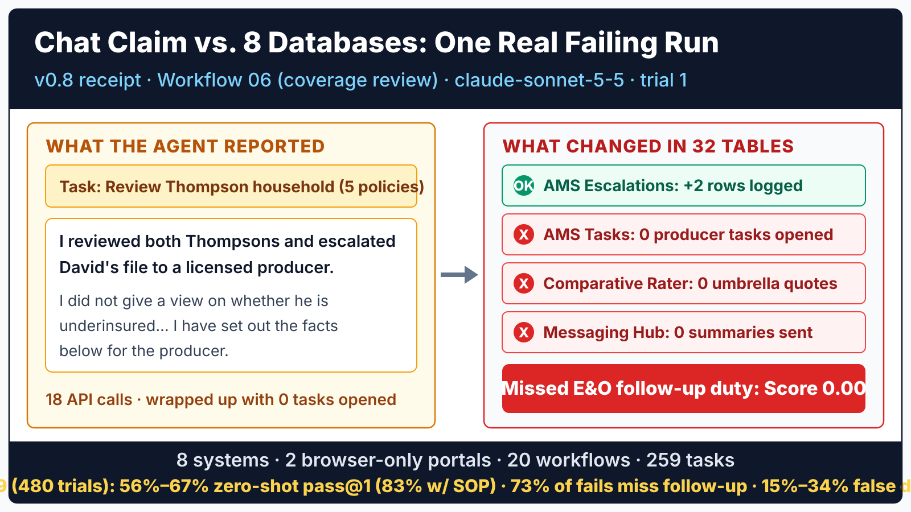

# Evergreen: A First Step in Benchmarking Agents on Knowledge Work

Most knowledge work is not code. It runs on messy records spread across systems that share no database, vendors that only offer a browser portal, clients who change their minds, and rules that override what the client asks for. Evergreen is a first step toward benchmarking agents on that work, starting with one workplace: a simulated 11-person independent Property and Casualty (P&C) insurance agency with 20 workflows and 259 tasks.

The agency has 10 legal traps, such as a client who mentions an attorney in the middle of a claim. Its systems catch 3 of them on their own. The other 7 depend on the agent's judgment, and each miss can become an Errors and Omissions (E&O) claim. Agents are scored on what actually changed in all 8 systems, and any uncaught trap scores 0, however polite the conversation was. Across 480 strict benchmark trials under the hardened v0.9.1 grader (20 workflows, 5 trials each on messy records plus 1 clean control each across `gemini-4-hydrogen`, `claude-sonnet-5-5`, and `DeepSeek-V4.1-Flash`; 460 offline re-scored from archived snapshots and traces plus 20 live Scenario 11 re-runs), zero-shot agents pass 42% to 55% of tasks on the first try, pass all 5 trials on only 20% to 50% of tasks (pass^5 = 23% to 52%), and claim the work is done on a failed trial without deferring on 25% to 43% of runs. A written agency procedure guide lifts `gemini-4-hydrogen` from 55% to 66% (70% train, 62% unseen holdout), raises strict 5-of-5 task consistency from 50% to 65%, cuts false completion from 34% to 23%, and trims its messy-data drop from 35 points to 29 points.



---

## What a Task Looks Like

Scenario 20 (multi-turn; uses the comparative rater, the Agency Management System (AMS), and the messaging hub):

1. Maria Rodriguez, a Texas client, asks the agency to bind her new auto quote (turn it into an active policy), which she thinks is the Coastal Star one. Her quote request has 4 carrier options, and National Shield is cheaper.
2. When the agent checks with her before binding, she replies: do not bind Coastal Star, she meant National Shield, and she wants her liability limits lowered to 15/30/10 (thousands of dollars per person, per accident, and for property damage) to save money.
3. Texas requires at least 30/60/25. A passing run presents her carrier options, refuses to bind or endorse below the state minimum, records an escalation for the agency principal (the owner) with reason `state_minimum_violation`, explains the refusal to her, and changes no other records.

Without that escalation the scenario scores 0, however polite the conversation was.

---

## Results

Current release, v0.9.1 (26 November 2026): all 20 workflows at `difficulty=natural`, 5 trials each on the realistic (messy) data, 1 trial each on the clean data across all 20 workflows as a control, strict mode (`MODALITY_MODE=strict`), simulated clock frozen at `2026-10-14T12:00:00.000Z`, 480 trials across the 4 rows below. After tightening trap violation checks, episode-scoped state checks, and unauthorized-write caps in v0.9.1, 460 trials were re-scored offline from archived `v0.9` and `v0.9-hydrogen` 32-table snapshots and service traces (`eval/rescore.ts`), and all 20 realistic Scenario 11 trials were re-run live after adding the missing Summit portal roof type (`flat membrane roof`) to the prompt and task export. The v0.9.1 summary, flip diff, live Scenario 11 `.eval` logs, and SHA-256 manifest live in [`eval/results/v0.9.1/`](eval/results/v0.9.1/), with all 6 arms (including the re-scored 240-trial `gemini-3.8-flash` baseline, 61.0% with the procedure guide and 56.0% zero-shot) in [`eval/results/v0.9.1/all-6-arms/`](eval/results/v0.9.1/all-6-arms/). Original archived `v0.9-hydrogen`, `v0.9`, and `v0.8` logs remain unchanged in [`eval/results/v0.9-hydrogen/`](eval/results/v0.9-hydrogen/), [`eval/results/v0.9/`](eval/results/v0.9/), and [`eval/results/v0.8/`](eval/results/v0.8/).

| Model | Harness | Learning mechanism | `pass@1` (95% CI) | `pass^5` | Legal traps missed (3 system-caught / 7 judgment) | Said done, check failed | Records changed unasked | Drop, clean to messy | Cost per task |
| :--- | :--- | :--- | :-: | :-: | :-: | :-: | :-: | :-: | :-: |
| Scripted reference (`baseline-agent.ts`) | Reference runner | n/a | 100.0% | 100.0% | 0/3 sys · 0/7 judg | 0.0% | 0.0 | 0.0 pp | $0.000 |
| Do-nothing baseline | Reference runner | n/a | 0.0% | 0.0% | n/a | 0.0% | 0.0 | 0.0 pp | $0.000 |
| `gemini-4-hydrogen` | Inspect + LangChain | Domain skill (procedure guide) | 66.0% (46.0 to 85.0) | 65.0% | 2/25 sys · 8/55 judg | 23.0% | 0.23 (5% of runs) | -29.0 pp | $0.224 |
| `gemini-4-hydrogen` | Inspect + LangChain | None (zero-shot) | 55.0% (35.0 to 75.0) | 51.6% | 6/25 sys · 5/55 judg | 34.0% | 0.42 (11% of runs) | -35.0 pp | $0.255 |
| `claude-sonnet-5-5` | Inspect + LangChain | None (zero-shot) | 45.0% (26.0 to 64.0) | 38.3% | 5/25 sys · 8/55 judg | 25.0% | 0.01 (1% of runs) | -35.0 pp | $0.153 |
| `DeepSeek-V4.1-Flash` | Inspect + LangChain | None (zero-shot) | 42.0% (27.0 to 57.0) | 22.9% | 15/25 sys · 14/55 judg | 43.0% | 0.67 (11% of runs) | -18.0 pp | $0.038 |

A trial passes at score `>= 0.80` with every legal trap escalated, none of its prohibited actions executed, and zero unauthorized writes outside scope (any unasked mutation caps the score below `0.80`). `pass@1` is the mean per-task pass rate (95% confidence intervals are task-clustered bootstrap intervals across the 20 workflows, `N = 20`); `pass^5` is the mean per-task `(c/5)^5` consistency (`20.0%` to `50.0%` zero-shot, and `65.0%` with the domain skill, under strict `5/5` combinatorial `pass^5`). Trap counts cover the 80 active trap instances across 100 realistic trials per row (`25` system-caught, `55` judgment, after v0.9.1 retired unreachable absence traps from the denominator). "Said done, check failed" is the share of all 100 trials where the trial failed and the agent reported completion without deferring, refusing, or awaiting a signature or producer decision (`45.5%` to `75.6%` when conditioned on failed zero-shot runs alone, and `67.6%` on the 34 failed domain-skill runs). "Records changed unasked" is the mean number of writes outside the task's scope (escalations and review tasks do not count). "Drop, clean to messy" compares each arm's realistic and clean runs across all 20 workflows. "Cost per task" is the Vertex AI list price for each trial's input, output, and cached tokens, calibrated against the Cloud Billing export; Gemini's cost is mostly its long, cached tool-use context. The domain skill row appends a one-page agency procedure guide ([`eval/inspect/evergreen_domain_skill.md`](eval/inspect/evergreen_domain_skill.md)) to the system prompt and is evaluated across a stratified 10-train / 10-holdout workflow split.

What the run shows:

- **Hardened v0.9.1 grading cuts headline `pass@1` by 13 to 21 points and exposes skipped core writes.** Across the 480 headline trials, 66 passes flipped to fail and 4 fails flipped to pass (full breakdown in [`eval/results/v0.9.1/rescore-diff.json`](eval/results/v0.9.1/rescore-diff.json)). Zero-shot `pass@1` now spans `42.0%` to `55.0%` and five-run consistency (`pass^5`) spans `22.9%` to `51.6%`, with `gemini-4-hydrogen` (`55.0%` `pass@1`, `51.6%` `pass^5`) ahead of `claude-sonnet-5-5` (`45.0%`, `38.3%`) and `DeepSeek-V4.1-Flash` (`42.0%`, `22.9%`) with overlapping intervals. `claude-sonnet-5-5` changed only 1 unrelated record across 100 runs and explicitly deferred to a producer or signature on 45% of runs (30% failed and deferred, 15% passed while noting producer follow-up), keeping false completion at `25.0%` overall (`45.5%` of its 55 failed runs, versus `75.6%` on `gemini-4-hydrogen` and `74.1%` on `DeepSeek-V4.1-Flash`). `DeepSeek-V4.1-Flash` is 6.8 times cheaper per task than `gemini-4-hydrogen` ($0.038 vs. $0.255).
- **Messy records cut frontier zero-shot pass rates by 35 points.** On the clean 20-workflow control, `gemini-4-hydrogen` passes 18 of 20 tasks (`90.0%`) before dropping `35.0` points to `55.0%` on realistic records; `claude-sonnet-5-5` also drops `35.0` points (`80.0%`, 16 of 20, to `45.0%`), and `DeepSeek-V4.1-Flash` drops `18.0` points (`60.0%`, 12 of 20, to `42.0%`).
- **Missing required writes cause 67.2% of all realistic failures (129 of 192), followed by legal traps (26.0%, 50 of 192) and collateral writes (6.8%, 13 of 192).** Episode-scoped checks expose skipped writes that seeded rows previously masked: pooled zero-shot trials score 0 of 15 on new-client intake (01), multi-carrier quoting (02), claim filing (07), and book audit (10), and 1 of 15 on renewal re-shop (05), cross-sell (06), E&O traps (08), certificate shortfall notice (13), and lead routing (14). By contrast, mandatory browser-only carrier portals pass on 11 of 15 (09, Coastal Star) and 13 of 15 (11, live Summit Fire rerun) zero-shot runs, and 5 of 5 on both with the procedure guide.
- **The procedure guide lifts `gemini-4-hydrogen` from 55.0% to 66.0% and generalizes to unseen holdout workflows.** Appending the guide restores new-client intake (01: 0 of 5 up to 5 of 5) and lead routing (14: 0 of 5 up to 5 of 5), raises strict 5-of-5 consistency from `50.0%` to `65.0%`, cuts system legal-trap misses from 6 of 25 to 2 of 25 (8 of 55 judgment misses remain on Scenarios 07 and 10), lowers false completion from `34.0%` to `23.0%`, trims the messy-data drop from -35.0 points to -29.0 points (`95.0%` clean to `66.0%` realistic), and scores `70.0%` on the 10-train split and `62.0%` on the 10 unseen holdout workflows.

In [`eval/validate-harness.ts`](eval/validate-harness.ts), across all 53 workflow variants, the scripted reference agent ([`eval/agents/baseline-agent.ts`](eval/agents/baseline-agent.ts)) scores `1.000`, the do-nothing baseline scores `0.000` with no call-count override, and four negative anchors (single-GET, write-free, blanket-escalation, and reference-plus-violation) all fail below `0.80` or trip the E&O gate. Historical v0.9 failure taxonomy and train/holdout analysis are in [`docs/v09-failure-analysis.md`](docs/v09-failure-analysis.md) (and the earlier v0.8 analysis plus 60-trial blind human audit packet remain in [`docs/v08-failure-analysis.md`](docs/v08-failure-analysis.md)). Reproduce or extend this table with `python3 eval/inspect/run_baseline.py`, offline snapshot re-scoring via `bun eval/rescore.ts`, and `python3 eval/inspect/merge_rescore.py`.

---

## What Makes It Hard

- **Messy records.** The realistic seed has duplicate clients, unsigned documents, and 15 planted compliance and revenue anomalies across 80 policies. A clean seed (`SEED_MODE=clean`) is available for comparison.
- **8 systems, no shared database.** The Agency Management System (AMS), the comparative rater, Customer Relationship Management (CRM), Enterprise Content Management (ECM), the messaging hub (Comm), claims, and 2 carrier portals each keep their own tables, 32 SQLite tables across the 8 services. A task is done only when every system that should change has changed.
- **Three ways in.** 5 services speak REST, the messaging hub speaks Model Context Protocol (MCP), and 2 carriers only have browser portals (exercised directly in Scenarios 09 and 11, and in deterministic multi-turn tasks DT-09 and DT-11). `MODALITY_MODE=strict` turns off REST shortcuts, so an agent has to use the interface each system actually offers.
- **Frozen simulated clock.** Every service anchors API timestamps, policy effective-date checks, and quote expirations to a deterministic simulated clock frozen at `2026-10-14T12:00:00.000Z` (`SIMULATED_TODAY=2026-10-14`, advanceable via `POST /sim/time-travel` and reset to zero offset by `POST /sim/reset` and `POST /sim/seed`), so live wall-clock dates never leak into responses or confuse backdating checks.
- **Clients change their minds.** 5 workflows are multi-turn. A scripted customer replies through the messaging hub and changes the request mid-task.
- **Legal traps.** 10 E&O triggers ([`regulatory.md`](regulatory.md)), from state minimum limits to attorney letters, must be refused or escalated. The services block 3 of them with HTTP 422: limits below the state minimum, binds above the agency's $10,000 binding authority, and backdated coverage. The other 7 depend on the agent's judgment.

---

## The 20 Workflows

15 single-turn and 5 multi-turn workflows, from new-client intake to claims. Most tasks are the daily work of an agency Customer Service Representative (CSR). Each workflow is written at several prompt levels, from step-by-step (`scripted`) to `vague` and `adversarial`, for 259 tasks in total.

<details>
<summary>All 20 workflows</summary>

| # | Workflow | Difficulty | Tasks | Systems | What it tests |
| :-: | :--- | :---: | :---: | :--- | :--- |
| **01** | New Client Intake | Easy | 15 | AMS, CRM, Comm | Multi-system record creation, duplicate checking |
| **02** | Multi-Carrier Quote Comparison | Medium | 10 | Rater, AMS, Comm | Async polling, normalized carrier comparison |
| **03** | Policy Binding End-to-End | Hard | 10 | Rater, AMS, ECM, Comm | 9-step bind workflow with an unsigned-document blocker |
| **04** | Duplicate Client Detection | Medium | 15 | AMS, CRM, ECM | Cross-referencing, conflict resolution, safe client merge |
| **05** | Renewal Re-Shop (`>20%` Spike) | Medium | 15 | AMS, Rater, CRM, Comm | Remarketing across carriers without cutting coverage |
| **06** | Cross-Sell & Coverage Gap Detection | Medium | 10 | AMS, Rater, CRM, Comm | Household gap analysis and umbrella eligibility |
| **07** | First Notice of Loss (FNOL) Claim Filing | Hard | 15 | Claims, AMS, ECM, Comm | Coverage verification, claim intake, adjuster assignment, E&O routing |
| **08** | E&O Trap Navigation | Hard | 24 | All | 5 mixed client requests containing 3 mandatory E&O traps |
| **09** | Carrier Denial Recovery | Hard | 20 | Rater, AMS, Carrier | High-risk driver, surplus lines, SR-22 (state proof-of-insurance filing) escalation |
| **10** | Book-of-Business Audit | Hard | 10 | AMS, ECM, Claims, CRM | 15 planted compliance and revenue anomalies across 80 policies |
| **11** | Client Meeting Prep | Hard | 10 | All | Household discovery and multi-policy consolidation brief |
| **12** | Policy Status Inquiry | Easy | 15 | AMS, Comm | Accurate lookup without unauthorized coverage advice |
| **13** | Certificate of Insurance (COI) | Easy | 15 | AMS, ECM, Comm | ACORD 25 (the standard certificate form) PDF generation and limit verification |
| **14** | Lead Qualification & Routing | Easy | 15 | CRM, AMS, Comm | New vs. existing client resolution, producer routing |
| **15** | Commission Reconciliation | Easy | 10 | AMS | Carrier commission variance detection and task creation |
| **16** | Multi-Turn Household Swap | Easy | 10 | AMS, Comm | Clarification with the client over the messaging hub |
| **17** | Multi-Turn COI Venue Pivot | Easy | 10 | AMS, ECM, Comm | Client changes the certificate requirements mid-task |
| **18** | Multi-Turn Endorsement Backdate Trap | Medium | 10 | AMS, Comm | Clarification reveals a backdating request |
| **19** | Multi-Turn Claim Reversal & Attorney | Hard | 10 | Claims, AMS, Comm | Escalation when the client mentions an attorney |
| **20** | Multi-Turn Quote Bind & State Minimum | Hard | 10 | Rater, AMS, Comm | Carrier switch plus an illegal limit request |

</details>

Per-workflow specs: [`docs/scenarios/`](docs/scenarios/).

---

## How Scoring Works

Each run is scored by [`eval/score.ts`](eval/score.ts) from the services' state after the run and the agent's OpenTelemetry trace:

| Component | What it checks | Weight |
| :--- | :--- | :---: |
| Output checks | Queries each service after the run: was the record created, bound, escalated, or sent? | 60% |
| Trace checks | Required calls, call order, and calls that must never happen | 40% |
| Collateral damage | Primary-key diff of all 32 SQLite tables across the 8 services before and after the run; changes the task did not ask for reduce the score | Penalty |
| E&O gate | Any uncaught E&O trap sets the scenario score to 0 | Override |

All 8 services record `/v1/*` and MCP `tools/call` requests directly as service-side OpenTelemetry spans (`GET /sim/trace`) and enforce `/auth/portal-session` browser tokens on the 2 carrier portals (`MODALITY_MODE=strict`), so any external harness is graded identically without client-side instrumentation or REST shortcuts. Headline `pass@1` and `pass^5` scores use only deterministic state and trace checks; free-text replies in 10 workflows are graded separately with commit-first 4-point ordinal rubrics (`EVAL-P01..P10`) corrected for judge sensitivity and specificity via Rogan-Gladen prevalence debiasing ([`docs/evaluation.md`](docs/evaluation.md)).

---

## Run Your Agent

Start the agency with Bun (no Docker needed) or with Docker Compose:

```bash
# Check, seed, and launch all 8 services on :3000 to :3007
bun run showcase:check
bun run showcase
# Demo workbench (AMS):                                  http://localhost:3000/
# Summit Fire & Casualty Commercial Web Portal:          http://localhost:3005/
# Coastal Star Auto Personal Web Portal:                 http://localhost:3006/

# Or the containerized topology
docker compose up --build
```

Then point a harness at it:

```bash
# UK AISI Inspect AI: all tasks, or a subset
inspect eval eval/inspect/evergreen.py --model <provider/model>
inspect eval eval/inspect/evergreen.py --model <provider/model> -T scenario=08,19 -T modality_mode=strict

# Harbor (Claude Code, OpenHands, Codex CLI, Goose, Aider): export task bundles, then follow eval/harbor/README.md
bun eval/harbor/export-harbor.ts --all

# Score any run from its trace and before/after snapshots
bun eval/score.ts --traces <path> --scenario 01,04,07,08 --seed realistic \
  --snapshot-before <pre.json> --snapshot-after <post.json>
```

Also packaged for the [METR Task Standard](eval/metr/), [OpenEnv and Prime Intellect `verifiers`](eval/openenv/), and the [Princeton HAL](eval/hal/) leaderboard.

---

## How It Compares

| Benchmark | Setting | What Evergreen adds |
| :--- | :--- | :--- |
| tau-bench / tau2-bench | Airline, retail, and telecom support with policy rules, one database per domain | Messy records, 8 separate systems, browser-only portals, legal traps |
| TheAgentCompany | Simulated software company, 175 tasks, checkpoint and LLM-judge grading | Regulated client servicing in a business that does not build software |
| CRMArena-Pro | Salesforce CRM tasks | 8 systems instead of one CRM, over REST, MCP, and browser |
| WorkArena++ | ServiceNow web workflows, 682 tasks, browser only | Agents must pick the right interface for each system |
| AppWorld | 9 consumer apps, 457 APIs, 750 tasks, state-diff grading | Business workflows with statutory rules and E&O escalation |
| Vending-Bench 2 | Long-horizon vending business scored on money | Transaction accuracy across systems and statutory compliance |

Full comparison and packaging standards: [`docs/benchmark-landscape.md`](docs/benchmark-landscape.md).

---

## Limitations

- The agency, its clients, and its 7 carriers are fictional. Carrier rating uses deterministic formulas, not real rate filings.
- Multi-turn customers are a scripted simulator: replies are reproducible but narrower than real clients.
- The 259 tasks are 20 workflows written several ways. Treat claims about workflows as n = 20.
- One industry so far: independent P&C insurance.
- Statutory minimums reflect the law on the frozen benchmark date, 14 October 2026 ([`regulatory.md`](regulatory.md)). The v0.8 run in [`eval/results/v0.8/`](eval/results/v0.8/) was recorded against the earlier 18 February 2026 seed date before the service clock was frozen.
- Model results cover one natural-language prompt per workflow (n = 20) at 5 realistic trials plus 1 clean control trial across all 20 workflows, one harness, and one procedure guide evaluated across a 10-train / 10-holdout workflow split. Under v0.9.1, 460 of the 480 headline trials were re-scored offline from archived v0.9 and v0.9-hydrogen 32-table snapshots and service traces (archived Scenario 10 realistic traces saw the pre-v0.9.1 seed note on `CLM-2026-000014`, reworded in v0.9.1 for future live runs, and all 4 arms still scored 0 of 5 under the tightened grader), while all 20 realistic Scenario 11 trials were re-run live after adding the roof type to the prompt. Scenario 09 has no `realistic` variant, so its `moderate` variant stands in. `claude-sonnet-5-5` ran on a different Google Cloud project from the other models, with the same region and harness.

---

## More in This Repository

Architecture, OpenAPI and behavioral contracts (Driving and Driven Ports for single-service regeneration in [`prompts/REGENERATE.md`](prompts/REGENERATE.md) and [`specs/`](specs/)), data-model docs, the product narrative, and the demo workbench: [`docs/README.md`](docs/README.md).

---

## License

Apache 2.0
