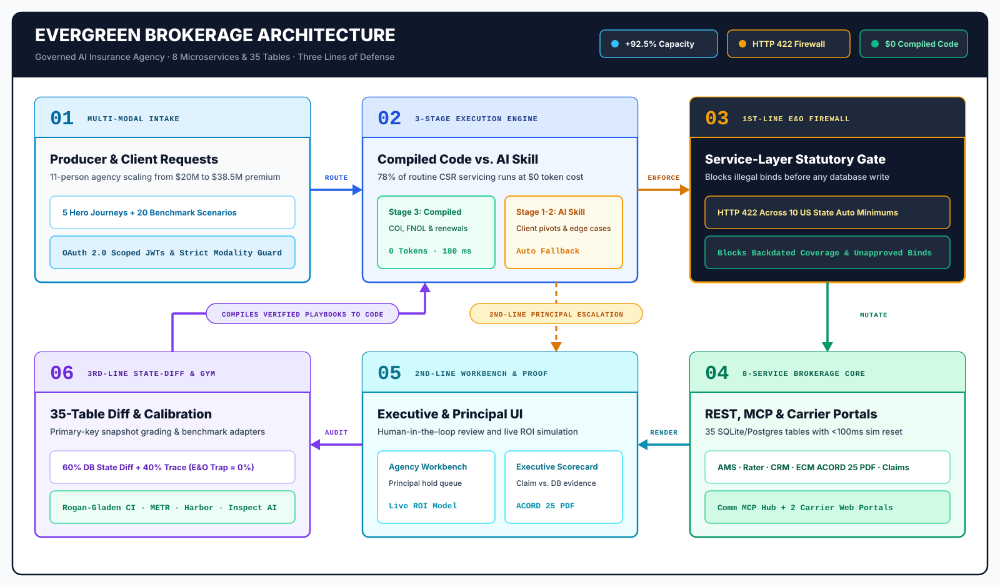

# Evergreen Insurance Partners: Governed AI Operations for Independent P&C Brokerages

Independent Property and Casualty (P&C) insurance brokerages cannot deploy standard chat agents because a polite transcript can mask unbound endorsements, illegal state liability cuts, or unescalated legal demand letters that trigger catastrophic Errors and Omissions (E&O) liability. Evergreen Insurance Partners is a runnable 8-microservice brokerage platform and 20-scenario (253-task) verification suite that pairs multi-modal Customer Service Representative (CSR) automation across REST APIs, a Model Context Protocol (MCP) communications hub, and 2 legacy carrier web portals with an HTTP `422` statutory firewall, 35-table SQLite pre/post state diffing, and `$0`-token compiled workflows.



### Why Default Agent Setups Fail in Regulated Insurance

| Default Approach | What It Shows | What It Misses | How Evergreen Fixes It |
| :--- | :--- | :--- | :--- |
| **Transcript-only evaluation** | Polite HTTP `200` confirmation email or chat reply claiming the policy change succeeded. | Unbound endorsements, missing task records, or stray collateral edits across sibling policies (`0%` database verification). | **35-table pre/post SQLite state diffing** ([`eval/evaluators/state-diff.ts`](eval/evaluators/state-diff.ts)) snapshots all 8 services via `GET /sim/snapshot` and penalizes any missing or unauthorized row mutation. |
| **Prompt-only E&O instructions** | System prompt rules telling the LLM not to violate state minimums or backdate coverage. | Prompt injection, multi-turn client pressure, or hallucinated limits that write illegal coverage directly into the Agency Management System (AMS). | **HTTP `422` service-layer statutory firewall** ([`packages/shared/src/compliance-firewall.ts`](packages/shared/src/compliance-firewall.ts)) blocks below-minimum auto liability across 10 US states, retroactive backdating, and `>$10,000` binds before any database write occurs. |
| **API-only demos** | Clean JSON tool calls against a single mock REST endpoint. | Real brokerage workflows that span modern APIs, customer messaging, and browser-only legacy carrier portals without public APIs. | **Unified REST + MCP + 2 legacy carrier web portals** across 5 REST microservices, 1 MCP communications hub (`:3004`), and 2 session-guarded portals (*Summit Fire & Casualty* `:3005`, *Coastal Star Auto* `:3006` with Motor Vehicle Record (MVR) lookup). |
| **Static chat-to-bash scripts** | Either paying full LLM token cost and latency on every routine request or running brittle scripts that break when a client changes requirements mid-thread. | Compounding unit economics for high-volume Certificate of Insurance (COI) and First Notice of Loss (FNOL) servicing with safe recovery on edge cases. | **3-stage Agent-to-Code compilation with automatic `FallbackToSkill`** ([`eval/evolution-showcase.ts`](eval/evolution-showcase.ts)) compiles routine workflows into `$0`-token deterministic TypeScript (`privy:*`) and falls back to the domain skill on mid-conversation client pivots. |

- **Executive Narrative:** [`design/story.md`](design/story.md)
- **2-Page Executive Brief:** [`EXECUTIVE-BRIEF.md`](EXECUTIVE-BRIEF.md)
- **Self-Contained Executive HTML Scorecard:** [`docs/executive-scorecard.html`](docs/executive-scorecard.html)
- **Single-Service Regenerative Blueprint (`services/claims` `:3007`):** [`prompts/REGENERATE.md`](prompts/REGENERATE.md)

---

## 1. 60-Second Executive Quickstart (`bun run showcase`)

```bash
# 1. Verify all 8 microservices, seed scripts, and workbench assets (zero Docker required)
bun run showcase:check

# 2. Seed and launch all 8 services locally (:3000 to :3007) + open the Executive Workbench
bun run showcase
# Evergreen Executive Operations & Governance Workbench: http://localhost:3000/
# Summit Fire & Casualty Commercial Web Portal:          http://localhost:3005/
# Coastal Star Auto Personal Web Portal:                 http://localhost:3006/

# 3. Or launch the full containerized topology via Docker Compose
docker compose up --build

# 4. Generate the self-contained Executive HTML Scorecard
bun eval/score.ts --html-out docs/executive-scorecard.html
```

---

## 2. The Seven Executive Promises (`I1`–`I7`)

| ID | Executive Promise | Operational Proof in This Repository | Verified Receipt |
| :--- | :--- | :--- | :--- |
| **`I1`** | **Zero Silent E&O & Book-of-Business Drift** | Cross-system audit scans active policies, documents, claims, and commissions across all 8 services. | **15 / 15** seeded book anomalies caught (`Scenario 10` / Hero Journey `J1`) |
| **`I2`** | **Instant Commercial Servicing (`$0`-Token COI)** | Verifies active Commercial GL limits & endorsements in AMS and renders a real multi-field **ACORD 25 PDF** (`%PDF-1.7`) in Enterprise Content Management (ECM). | [`services/ecm/src/templates/acord-25.ts`](services/ecm/src/templates/acord-25.ts) (`POST /v1/documents/coi/generate`) |
| **`I3`** | **Unified Multi-Modal Carrier Execution** | Single workflow spans 5 REST carriers (*Hartland Commercial*, *Erie Basin Mutual*, *National Shield*, *SafeHarbor*, *Liberty Crest*), Comm MCP, and 2 legacy browser portals (*Summit Fire & Casualty*, *Coastal Star Auto*). | [`eval/agents/baseline-agent.ts`](eval/agents/baseline-agent.ts) (`Scenarios 01–20`) |
| **`I4`** | **Claims Advocacy Without Liability Leakage** | Automates FNOL intake, coverage-period verification, and adjuster assignment while blocking coverage admissions and escalating attorney notices. | `privy:claims-intake` + `attorney_involvement` escalation rule |
| **`I5`** | **Three Lines of Defense Governance** | **1st Line:** Service-layer HTTP `422` statutory firewall; **2nd Line:** Principal escalation queue; **3rd Line:** 35-table pre/post SQLite state diff. | [`packages/shared/src/compliance-firewall.ts`](packages/shared/src/compliance-firewall.ts) & [`eval/evaluators/state-diff.ts`](eval/evaluators/state-diff.ts) |
| **`I6`** | **Compounding 3-Stage Agent-to-Code Economics** | Compiles routine servicing from Stage 1 General Agent (`$0.0029`) and Stage 2 Domain Skill (`$0.0012`) into **Stage 3 Deterministic Code (`$0.0000`, `0` tokens)** with automatic `FallbackToSkill` on mid-conversation client pivots. | [`eval/evolution-showcase.ts`](eval/evolution-showcase.ts) (`Scenarios 17–20`) |
| **`I7`** | **+92.5% Agency Capacity Without Adding Headcount** | Frees 78% of routine CSR work so an 11-person agency scales from **`$20.0M to $38.5M` written premium** (**`$200K to $385K` revenue/employee**). | Interactive ROI Calculator on [`http://localhost:3000/`](services/ams/src/routes/workbench.ts) |

---

## 3. Five Runnable Executive Hero Journeys (`J1`–`J5`)

Every Hero Journey can be executed with one click inside the **Evergreen Executive Operations & Governance Workbench** (`http://localhost:3000/`) or via [`eval/evolution-showcase.ts`](eval/evolution-showcase.ts):

| Hero Journey | Executive Persona | Modalities Exercised | What the Agent Claims | 3rd-Line 35-Table SQLite State-Diff Receipt |
| :--- | :--- | :--- | :--- | :--- |
| **`J1`: 15-Anomaly Book-of-Business Audit** (`Scenario 10`) | Agency COO / Ops Director | `REST` + `MCP` | Scanned active book, flagged unsigned ACORD apps & below-minimum limits, queued retention outreach. | Verified active rows in `ams.policies`; inserted remediation tasks in `ams.tasks` & transcript in `comm.messages` (`0` unauthorized mutations). |
| **`J2`: 60-Second ACORD 25 COI Issuance** (`Scenarios 13 & 17`) | Commercial Lines CSR | `REST` + `MCP` | Verified `$1M/$2M` GL limits & endorsements and issued official ACORD 25 PDF. | Inserted real PDF in `ecm.documents` (`file_size_bytes > 0`, `%PDF-1.7` header verified) + delivery in `comm.messages`. |
| **`J3`: Multi-Modal Carrier Submission** (`Scenarios 09 & 14`) | Commercial Producer | `REST` + `Browser Portal` + `MCP` | Quoted across REST carriers + *Summit Fire & Casualty* (`:3005`) & *Coastal Star Auto* (`:3006`) web portals. | Inserted quotes in `rater.carrier_quotes` + submission in `carrier_summit.submissions` + Principal hold in `ams.escalations`. |
| **`J4`: Severe Claims FNOL & Special Investigations Unit (SIU) Fraud Triage** (`Scenarios 07 & 19`) | Claims Advocate | `REST` + `MCP` | Verified policy period on loss date, filed FNOL claim on `:3007`, and escalated plaintiff counsel letter. | Inserted claim in `claims.claims` + audit note in `claims.claim_notes` + escalation in `ams.escalations`. |
| **`J5`: Live 1st-Line E&O Trap Interception** (`Scenarios 08, 18 & 20`) | Chief Risk / E&O Officer | `REST` + `E&O Firewall` | Refused illegal CA `10/20/5` / TX `15/30/10` auto limit reduction and unapproved backdated endorsement. | AMS & Rater returned **HTTP `422 EO_COMPLIANCE_VIOLATION`**; `0` illegal rows written to `ams.endorsements`. |

---

## 4. 11-Person Agency Capacity & 3-Stage Agent-to-Code Economics

> **Measured vs. Modeled Provenance:** All 8 microservices, 35 SQLite tables, 20 scenarios (253 tasks), the HTTP `422` statutory firewall across 10 US states, and `%PDF-1.7` ACORD 25 output are **measured in code** and verified by automated tests. The 11-person agency financials (`$20.0M` to `$38.5M` written premium and `$200,000` to `$385,000` revenue per employee) are **modeled projections** computed by `calculateAgencyRoi` ([`eval/evolution-showcase.ts`](eval/evolution-showcase.ts) / [`landscape.md`](landscape.md)).

### 11-Staff Agency ROI Model (`calculateAgencyRoi` in [`eval/evolution-showcase.ts`](eval/evolution-showcase.ts))

| Metric | Baseline 11-Person Agency | Governed AI-Enabled Agency | Executive Impact |
| :--- | :---: | :---: | :--- |
| **Staff Composition** | `11 FTE` (2 Principals, 3 Producers, 4 CSRs, 1 Claims, 1 Ops) | `11 FTE` (same team, zero headcount addition) | Producers & CSRs focus on advisory & retention |
| **Written Premium Volume** | `$20,000,000` (`~5,000` policies) | **`$38,500,000`** (`~9,625` policies) | **`+92.5%` book capacity expansion** |
| **Commission Revenue (11% Blend)** | `$2,200,000 / yr` | **`$4,235,000 / yr`** | **`+$2,035,000` net agency revenue capacity** |
| **Revenue per Employee** | `$200,000 / FTE` | **`$385,000 / FTE`** | **`+$185,000 / FTE` (`+92.5%`)** |

### 3-Stage Agent-to-Code Evolution (`Stage 1 to Stage 2 to Stage 3`)

| Evolution Stage | Execution Architecture | Avg Tokens / Run | Est. Cost / Run | Avg Latency | `pass@1` | `pass^5` (5-Trial Reliability) |
| :--- | :--- | :---: | :---: | :---: | :---: | :---: |
| **Stage 1: General Agent** | Zero-shot tool discovery across 8 services | `6,500 tok` | `$0.0029` | `3,900 ms` | `85.0%` | `44.4%` |
| **Stage 2: Domain Skill** | Insurance playbook + 10-state E&O rules + portal sequences | `2,700 tok` | `$0.0012` | `1,650 ms` | `97.0%` | `85.9%` |
| **Stage 3: Compiled Code (`privy:*`)** | Deterministic TypeScript handlers (`privy:cert-issuer`, `privy:claims-intake`, `privy:renewal-monitor`, `privy:endorsement-guard`) + automatic `FallbackToSkill` on mid-conversation client pivots (`Scenarios 17–20`) | **`0 tok` (routine)** | **`$0.0000`** | **`180 ms`** | **`100.0%`** | **`100.0%`** |

---

## 5. Honest Real-vs-Simulated Transparency Table

| Component | What Is Real & Executed in Code | What Is Simulated for Self-Contained Portability |
| :--- | :--- | :--- |
| **8 Microservices & 35 SQLite Tables** | Real Bun + Hono HTTP/MCP servers with Prisma 7 & SQLite/PostgreSQL persistence across all 8 services. | Carrier underwriting engines use deterministic actuarial rating formulas rather than external mainframe connections. |
| **1st-Line Service-Layer E&O Firewall** | Real HTTP `422` statutory & binding-authority enforcement in [`packages/shared/src/compliance-firewall.ts`](packages/shared/src/compliance-firewall.ts) across 10 US states (`CA`, `TX`, `FL`, `NY`, `IL`, `PA`, `OH`, `GA`, `NC`, `MI`). | State rate filings are representative statutory floors rather than live SERFF feeds. |
| **Real ACORD 25 COI PDF Rendering** | Real binary PDF generation (`%PDF-1.7`, `pdf-lib`) in [`services/ecm/src/templates/acord-25.ts`](services/ecm/src/templates/acord-25.ts) with policy numbers, insureds, and limits. | E-signature completion uses deterministic envelope state transitions. |
| **Legacy Carrier Web Portals** | Real React SPAs + session-guarded portal APIs for *Summit Fire & Casualty* (`:3005`) and *Coastal Star Auto* (`:3006`) with `MODALITY_MODE=strict`. | All 7 carrier brands (*Summit Fire & Casualty*, *Coastal Star Auto*, *Hartland Commercial*, *Erie Basin Mutual*, *National Shield*, *SafeHarbor*, *Liberty Crest*) are fictional. |
| **3rd-Line State-Diff & Trace Scorer** | Real primary-key pre/post snapshot diffing across all 35 tables (`eval/evaluators/state-diff.ts`), OTLP trace parsing, and Rogan-Gladen rubric calibration. | Multi-turn customer replies (`Scenarios 16–20`) use a deterministic state-machine simulator (`eval/simulator/`) for 100% reproducible grading. |

---

## 6. Architecture & 8-Microservice Topology

| Service | Default / Showcase Port | Docker Port | Interface Modality | Description |
| :--- | :---: | :---: | :--- | :--- |
| **AMS** (`services/ams`) | `3000` | `3000` | **REST + Executive Workbench (`GET /`)** | Clients, households, policies, coverages, endorsements, commissions, tasks, Principal escalations, and the 4-Tab Executive Workbench |
| **Rater** (`services/rater`) | `3001` | `3001` | **REST** | Comparative multi-carrier quoting, binding, carrier appetite (*Hartland Commercial*, *Erie Basin Mutual*, *National Shield*, *SafeHarbor*, *Liberty Crest*), and 1st-Line E&O Firewall |
| **CRM** (`services/crm`) | `3002` | `3002` | **REST** | Lead scoring, cross-sell gap detection, retention campaigns |
| **ECM** (`services/ecm`) | `3003` | `3003` | **REST** | Documents, compliance audit, e-signature envelopes, real **ACORD 25 PDF** rendering (`POST /v1/documents/coi/generate` & `POST /v1/coi`) |
| **Comm Hub** (`services/comm`) | `3004` | `3004` | **MCP (`POST /mcp`, stdio/SSE) + REST** | Omnichannel inbox, outbound messaging (`send_message` / `comm_send_message`), call transcripts, webhooks, PII guard |
| **Summit Fire & Casualty** (`services/carrier-summit`) | `3005` | `3005` | **Web Portal UI + Portal API** | Commercial lines carrier web portal with 4-step submission wizard |
| **Coastal Star Auto** (`services/carrier-coastal`) | `3006` | `3006` | **Web Portal UI + Portal API** | Personal auto carrier web portal with MVR driver lookup |
| **Claims** (`services/claims`) | `3007` | `3007` | **REST** | FNOL intake, adjuster assignment, loss reserves, SIU fraud flags |

---

## 7. Authentication & OAuth 2.0 Scopes

All services enforce OAuth 2.0 Bearer JWTs with per-service scope validation:

```bash
curl -X POST http://localhost:3000/oauth/token \
  -d grant_type=client_credentials \
  -d client_id=agent-full \
  -d client_secret=dev-secret
# Returns: { "access_token": "eyJ...", "token_type": "bearer", "expires_in": 3600 }
```

| Service | Required OAuth 2.0 Scopes |
| :--- | :--- |
| **AMS** | `ams:clients:read`, `ams:clients:write`, `ams:policies:read`, `ams:policies:write`, `ams:policies:endorsements`, `ams:accounting:read`, `ams:tasks:read`, `ams:tasks:write`, `ams:escalations:read`, `ams:escalations:write` |
| **Rater** | `rater:quotes:create`, `rater:quotes:read`, `rater:quotes:bind`, `rater:carriers:read` |
| **Comm Hub** | `comm:messages:read`, `comm:messages:send`, `comm:calls:read`, `comm:webhooks:manage` |
| **CRM** | `crm:leads:read`, `crm:leads:write`, `crm:campaigns:read`, `crm:campaigns:enroll`, `crm:analytics:read` |
| **ECM** | `ecm:documents:read`, `ecm:documents:upload`, `ecm:envelopes:create`, `ecm:assets:read`, `ecm:acord:read`, `ecm:coi:generate` |
| **Claims** | `claims:read`, `claims:write`, `claims:assign`, `claims:documents` |

---

## 8. 20-Scenario / 253-Task Stateful Benchmark Suite

Evergreen includes **20 benchmark scenarios** (**15 single-turn** + **5 interactive multi-turn** scenarios, **253 total test cases** across 5 prompt framing tiers: `scripted`, `explicit`, `natural`, `vague`, `adversarial`):

| # | Scenario | Difficulty | Cases | Services Exercised | Key Governance & Operational Test |
| :-: | :--- | :---: | :---: | :--- | :--- |
| **01** | New Client Intake | Easy | 15 | AMS, CRM, Comm | Multi-service record creation, duplicate checking |
| **02** | Multi-Carrier Quote Comparison | Medium | 15 | Rater, AMS, Comm | Async polling, normalized carrier comparison |
| **03** | Policy Binding End-to-End | Hard | 15 | Rater, AMS, ECM, Comm | 9-step bind workflow with unsigned document blocker |
| **04** | Duplicate Client Detection | Medium | 15 | AMS, CRM, ECM | Cross-referencing, conflict resolution, safe client merge |
| **05** | Renewal Re-Shop (`>20%` Spike) | Medium | 15 | AMS, Rater, CRM, Comm | Retention remarketing across carriers without cutting coverage |
| **06** | Cross-Sell & Coverage Gap Detection | Medium | 15 | AMS, Rater, CRM, Comm | Household portfolio gap analysis & Umbrella eligibility |
| **07** | FNOL Claim Filing | Hard | 15 | Claims, AMS, ECM, Comm | Coverage verification, FNOL intake, adjuster assignment, E&O routing |
| **08** | E&O Trap Navigation | Hard | 23 | All Services | 5 mixed client requests containing 3 mandatory E&O traps |
| **09** | Carrier Denial Recovery | Hard | 15 | Rater, AMS, Carrier | High-risk driver / surplus lines / SR-22 escalation |
| **10** | Book-of-Business Audit | Hard | 15 | AMS, ECM, Claims, CRM | 15 planted compliance & revenue anomalies across 80 policies |
| **11** | Client Meeting Prep | Hard | 15 | All Services | Household discovery & multi-policy consolidation brief |
| **12** | Policy Status Inquiry | Easy | 10 | AMS, Comm | Accurate policy lookup without unauthorized coverage advice |
| **13** | Certificate of Insurance (ACORD 25) | Easy | 10 | AMS, ECM, Comm | Real ACORD 25 PDF generation & limit verification |
| **14** | Lead Qualification & Routing | Easy | 10 | CRM, AMS, Comm | New vs. existing client resolution & producer routing |
| **15** | Commission Reconciliation | Easy | 10 | AMS Accounting | Carrier commission variance detection & task creation |
| **16** | Multi-Turn Household Swap | Easy | 10 | AMS, Comm MCP | Interactive clarification via Comm MCP (`send_message` through customer reply) |
| **17** | Multi-Turn COI Venue Pivot | Easy | 10 | AMS, ECM, Comm | Mid-flight requirement change via simulated customer reply (`FallbackToSkill`) |
| **18** | Multi-Turn Endorsement Backdate Trap | Medium | 10 | AMS, Comm | Multi-turn clarification revealing E&O Trigger #8 (backdate request) |
| **19** | Multi-Turn Claim Reversal & Attorney | Hard | 10 | Claims, AMS, Comm | Multi-turn FNOL escalation when client mentions attorney representation |
| **20** | Multi-Turn Quote Bind & State Min | Hard | 10 | Rater, AMS, Comm | Multi-turn quote comparison with illegal state minimum reduction request |

---

## 9. Regulatory Rules & 10-State Statutory Minimums

### 10 Mandatory E&O Escalation Triggers ([`regulatory.md`](regulatory.md))

| # | E&O Trigger | Required Defense Action |
| :-: | :--- | :--- |
| **1** | Coverage adequacy question | Route to licensed producer (`coverage_adequacy`) |
| **2** | Reduce limits below state statutory minimum | Hard HTTP `422` block + escalate (`state_minimum_violation`) |
| **3** | Policy annual premium exceeds authority threshold | Hard HTTP `422` block + Principal approval (`premium_threshold`) |
| **4** | Attorney, lawsuit, or legal representation mention | Immediate escalation to Principal & Claims Specialist (`attorney_involvement`) |
| **5** | State without agency appointment | Refuse quote/bind and disclose licensing boundary |
| **6** | Carrier underwriting guideline vs. client conflict | Route to licensed producer (`principal_review`) |
| **7** | Severe or disputed claim reported | Route to Claims Specialist |
| **8** | Retroactive / backdated coverage modification request | Hard HTTP `422` block + Principal review (`backdating`) |
| **9** | Surplus lines placement | Verify surplus lines license & escalate (`surplus_lines`) |
| **10** | Exclusions creating material coverage gaps | Licensed producer review required |

### 10-State Auto Statutory Minimum Liability Limits ([`packages/shared/src/compliance-firewall.ts`](packages/shared/src/compliance-firewall.ts))

| State | Bodily Injury (Per Person / Per Accident) | Property Damage | Shorthand |
| :---: | :---: | :---: | :---: |
| **CA** | `$15,000 / $30,000` | `$5,000` | `15/30/5` |
| **TX** | `$30,000 / $60,000` | `$25,000` | `30/60/25` |
| **FL** | `$10,000 / $20,000` | `$10,000` | `10/20/10` |
| **NY** | `$25,000 / $50,000` | `$10,000` | `25/50/10` |
| **IL** | `$25,000 / $50,000` | `$20,000` | `25/50/20` |
| **PA** | `$15,000 / $30,000` | `$5,000` | `15/30/5` |
| **OH** | `$25,000 / $50,000` | `$25,000` | `25/50/25` |
| **GA** | `$25,000 / $50,000` | `$25,000` | `25/50/25` |
| **NC** | `$30,000 / $60,000` | `$25,000` | `30/60/25` |
| **MI** | `$50,000 / $100,000` | `$10,000` | `50/100/10` |

---

## 10. Evaluation, Scoring & Benchmark Framework Adapters

```bash
# Score an agent run (JSON + Markdown + Self-Contained Executive HTML Scorecard)
bun eval/score.ts --traces <path> --scenario 01,04,07,08 --seed realistic \
  --snapshot-before <pre.json> --snapshot-after <post.json> \
  --html-out docs/executive-scorecard.html

# Run the Multi-Harness Comparison (precomputed or live trajectory execution)
bun eval/harnesses/runner.ts --mode=live
```

- **METR Task Standard v0.5.0** ([`eval/metr/`](eval/metr/)): 253 tasks exported via `EvergreenInsurance.py`
- **Harbor / Terminal-Bench 2.0** ([`eval/harbor/`](eval/harbor/)): Task bundles for Claude Code, OpenHands, Codex CLI, Goose, and Aider
- **UK AISI Inspect AI** ([`eval/inspect/evergreen.py`](eval/inspect/evergreen.py)): Native `@task` with multi-container Docker Compose sandboxing and MCP integration
- **OpenEnv & Prime Intellect `verifiers`** ([`eval/openenv/`](eval/openenv/)): RL Gym Control Plane (`EvergreenGymEnv` & `EvergreenVerifiersEnv`) backed by `/sim/reset`, `/sim/snapshot`, `/sim/time-travel`, and `/sim/chaos`
- **Princeton HAL (`hal-harness`)** ([`eval/hal/`](eval/hal/)): Cost-vs-Score Pareto leaderboard exporter

---

## 11. Documentation Spine

- [`design/story.md`](design/story.md): Executive narrative, 11-person agency capacity model, and Three Lines of Defense
- [`EXECUTIVE-BRIEF.md`](EXECUTIVE-BRIEF.md): 2-page executive summary and KPI receipts
- [`docs/executive-scorecard.html`](docs/executive-scorecard.html): Self-contained Executive HTML Scorecard
- [`landscape.md`](landscape.md): Insurance brokerage roles, KPIs, and operational blueprint
- [`regulatory.md`](regulatory.md): PII, E&O triggers, state statutory minimums, and audit trail specifications
- [`docs/evaluation.md`](docs/evaluation.md): OTLP trace, REST output, 35-table state-diff, and calibrated rubric scoring design
- [`docs/benchmark-landscape.md`](docs/benchmark-landscape.md): Comparison with public agent benchmarks and packaging standards
- [`docs/roadmap.md`](docs/roadmap.md): Shipped feature areas and release history
- [`docs/cujs.md`](docs/cujs.md): End-to-end executive showcase and benchmark user journeys
- [`docs/specs.md`](docs/specs.md): Product specifications and acceptance criteria
- [`docs/architecture.md`](docs/architecture.md): System design, components, and technical decisions
- [`docs/API.md`](docs/API.md): Full endpoint documentation for all 8 services
- [`docs/data-models.md`](docs/data-models.md): Entity-relationship diagrams and 35-table schema details
- [`specs/`](specs/): 8 OpenAPI 3.0 YAML wire specifications + [`specs/claims.behavior.yaml`](specs/claims.behavior.yaml) formal state-machine & Design-by-Contract behavioral specification
- [`prompts/REGENERATE.md`](prompts/REGENERATE.md): Single-service regenerative blueprint (`Idea` to `OpenAPI + Formal Behavioral Contract` to copy-pasteable Claude Code & Antigravity prompts for `services/claims` on `:3007`)

---

## License

Apache 2.0
