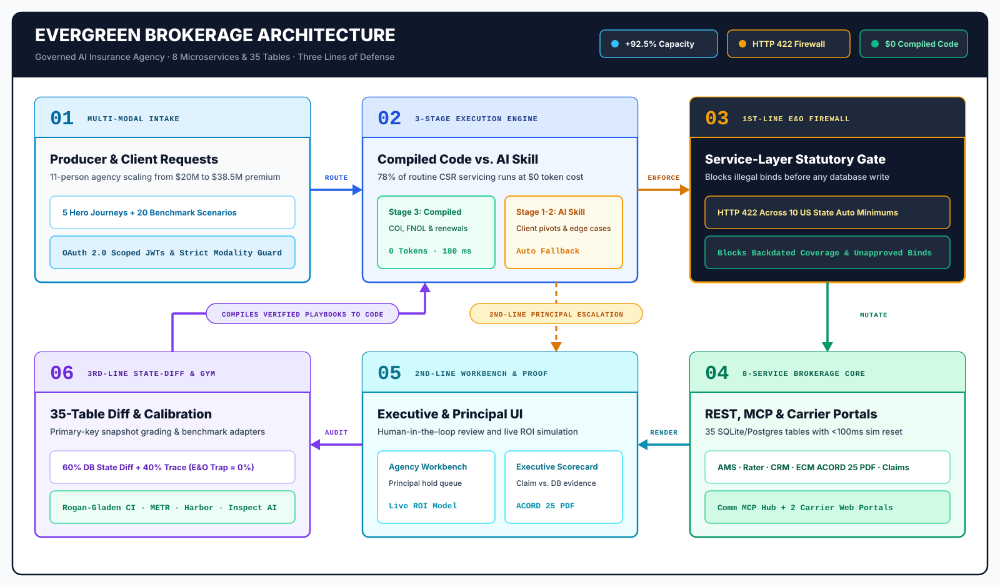

# Evergreen Insurance Partners: The Executive Story (`design/story.md`)

**Audience:** Insurance Technology Executives, Independent Agency Principals, COOs, and Chief Risk / E&O Officers  
**Core Thesis:** Independent insurance agencies do not have a "chatbot problem"; they have a **servicing capacity and Errors & Omissions (E&O) governance bottleneck**. Evergreen pairs an analytical capacity model for an 11-person independent brokerage (**$20.0M to $38.5M modeled written premium, `+92.5%`**, or **$200,000 to $385,000 modeled revenue per employee**) with a runnable 8-microservice testbed, a deterministic **Three Lines of Defense** governance architecture, and empirical multi-model Inspect AI evaluations.

---

## 1. The Operational Reality of an 11-Person Independent Agency

**Evergreen Insurance Partners** is a simulated 11-person P&C brokerage (`2` Agency Principals, `3` Commercial & Personal Lines Producers, `4` Customer Service Representatives / Account Managers, `1` Claims Advocate, and `1` Operations Coordinator) managing **~5,000 policies** across **8 disconnected systems**:

1. **Agency Management System (`AMS`, `:3000`):** Client households, policies, coverages, endorsements, commissions, tasks, and principal escalations.
2. **Comparative Rater (`Rater`, `:3001`):** Multi-carrier rating and binding across 5 REST carriers (*Hartland Commercial*, *Erie Basin Mutual*, *National Shield*, *SafeHarbor*, *Liberty Crest*).
3. **Agency CRM (`CRM`, `:3002`):** Lead scoring, cross-sell gap analysis, and renewal retention campaigns.
4. **Enterprise Content Management (`ECM`, `:3003`):** Signed ACORD applications, loss runs, e-signature envelopes, and live **ACORD 25 Certificate of Insurance (COI) PDF** rendering.
5. **Omnichannel Communications Hub (`Comm`, `:3004`):** Client SMS/email inbox, call transcripts, and outbound notifications exposed via the **Model Context Protocol (MCP)**.
6. **Legacy Carrier Web Portal: Summit Fire & Casualty (`:3005`):** Browser-only 4-step commercial submission wizard (`MODALITY_MODE=strict`).
7. **Legacy Carrier Web Portal: Coastal Star Auto (`:3006`):** Browser-only personal auto portal with MVR driver checks (`MODALITY_MODE=strict`).
8. **Claims Management (`Claims`, `:3007`):** First Notice of Loss (FNOL), adjuster assignment, reserve tracking, and Special Investigations Unit (SIU) fraud triage.

### Why Traditional Agency Automation Stalls

In our baseline 11-person agency model (`$20M` written premium, `$2.2M` commission revenue at an 11% blended rate, or **`$200,000` modeled revenue per employee**):
- **Modeled 78% of routine CSR capacity** (`calculateAgencyRoi` in [`eval/evolution-showcase.ts`](../eval/evolution-showcase.ts)) is consumed by repetitive cross-system servicing: issuing ACORD 25 COIs, re-keying commercial submissions into legacy carrier web portals, auditing commission statements, and re-shopping renewal rate spikes (`>20%`).
- **Unconstrained AI assistants fail the E&O test:** As measured in Evergreen's zero-shot LLM benchmark runs (`v0.8` run, 20 workflows x 5 trials: `55% to 59%` zero-shot `pass@1`, `37% to 50%` false-completion rate), general-purpose agents frequently report completion when state assertions fail, and any agent that lowers a California auto policy to `10/20/5` (below the `30/60/15` statutory floor), backdates a collision deductible reduction prior to a parking-lot loss, or binds a `$34,800` commercial package without Principal sign-off exposes the agency to severe Errors & Omissions liability.

---

## 2. Seven Operational Capabilities (`I1` to `I7`)

Evergreen separates **deterministic code guarantees** and **measured LLM benchmark runs** from **modeled agency ROI projections**:

| ID | Capability | Provenance & Operational Proof in Evergreen |
| :--- | :--- | :--- |
| **`I1`** | **Book-of-Business Anomaly Detection** | **Measured Verifier:** Cross-system audit scenario (`Scenario 10`) plants **15 seeded book anomalies** (unsigned ACORD forms, below-minimum state limits, unapplied endorsements, duplicate households, commission variances) verified by [`eval/agents/baseline-agent.ts`](../eval/agents/baseline-agent.ts). |
| **`I2`** | **Binary ACORD 25 COI Rendering** | **Measured in Code:** Verifies active Commercial GL/Umbrella limits in AMS, renders a real multi-field **ACORD 25 PDF** (`%PDF-1.7`, `pdf-lib`) in [`services/ecm/src/templates/acord-25.ts`](../services/ecm/src/templates/acord-25.ts), and serves it via `GET /v1/documents/coi/:id/pdf`. |
| **`I3`** | **Strict 3-Modality Carrier Execution** | **Measured in Code:** Enforces `MODALITY_MODE=strict` (OAuth JWTs on REST + `/mcp`, plus portal bootstrap cookies and `X-Portal-Session` tokens on `:3005` and `:3006`) across **REST APIs**, **MCP JSON-RPC 2.0**, and **2 browser portals**. |
| **`I4`** | **Claims Intake & Calibrated Communication Rubrics** | **Measured in Code:** Automates FNOL intake and adjuster assignment on `:3007` while grading client-facing communication safety against 10 `EVAL-P01..P10` criteria calibrated on a 120-item dual-expert gold set (`eval/calibration/rubric_gold_120.json`). |
| **`I5`** | **Three Lines of Defense Governance** | **Measured in Code:** **1st Line:** Hard service-layer HTTP `422` E&O firewall; **2nd Line:** Client- and reason-scoped Principal approval queue (`>$10K` authority cap); **3rd Line:** 32-table SQLite pre/post state-diff & `collateralPolicy` auditor. |
| **`I6`** | **3-Stage Agent-to-Code Progression** | **Measured + Modeled:** Compares **Stage 1 Zero-Shot General Agents** (measured Inspect AI runs) and **Stage 2 Domain Skill SOPs** (`eval/inspect/evergreen_domain_skill.md`) against **Stage 3 Deterministic Reference Handlers** ([`eval/agents/baseline-agent.ts`](../eval/agents/baseline-agent.ts), `0` LLM tokens, `20/20` verified via `bun eval/validate-harness.ts`) with agent fallback on unstructured pivots (`Scenarios 17–20`). |
| **`I7`** | **+92.5% Modeled Agency Capacity** | **Modeled ROI Projection:** Analytical capacity model (`calculateAgencyRoi` in [`eval/evolution-showcase.ts`](../eval/evolution-showcase.ts)) illustrating how automating 78% of routine CSR servicing expands an 11-person agency from **$20.0M to $38.5M written premium** (**`$200,000` to `$385,000` revenue per employee**). |

---

## 3. Three Lines of Defense Architecture

1. **1st Line of Defense: Deterministic Service-Layer E&O Firewall ([`packages/shared/src/compliance-firewall.ts`](../packages/shared/src/compliance-firewall.ts)):**
   - Enforced directly inside AMS (`POST /v1/policies`, `POST /v1/policies/:id/endorsements`) and Rater (`POST /v1/quotes/:quote_id/bind`) **before any database write can occur**.
   - Unconditionally enforces statutory minimum auto liability limits across **10 states** (`CA`, `TX`, `FL`, `NY`, `IL`, `PA`, `OH`, `GA`, `NC`, `MI`; never waivable by manager escalation), blocks unapproved retroactive backdating (`E_EO_BACKDATING_PROHIBITED`), and enforces client-scoped principal binding authority caps (`E_EO_PREMIUM_THRESHOLD_EXCEEDED`) with deterministic HTTP `422` responses.
2. **2nd Line of Defense: Principal E&O & Underwriting Escalation Queue ([`services/ams/src/routes/escalations.ts`](../services/ams/src/routes/escalations.ts)):**
   - High-risk binds, surplus-lines placements, and attorney notices are routed to `ams.escalations` with full audit trails in `ams.escalation_events` and interactive Principal Approve / Deny controls in the Executive Workbench (`http://localhost:3000/`).
3. **3rd Line of Defense: 32-Table SQLite State-Diff & Collateral Damage Auditor ([`eval/evaluators/state-diff.ts`](../eval/evaluators/state-diff.ts)):**
   - Snapshots all **32 tables across all 8 services** (`GET /sim/snapshot`) before and after every workflow run and enforces per-scenario `collateralPolicy` bounds (`allowedClientIds`, `allowedPolicyIds`, `maxTotalMutations`), penalizing any unauthorized cross-client mutation.
