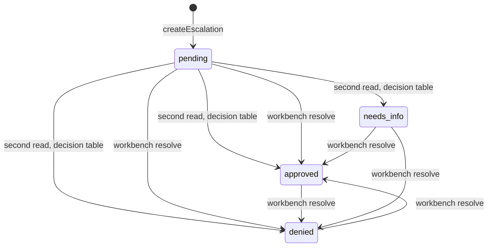

# AMS behaviour spec

Behaviour of the Agency Management System service (`ams`, port 3000), written so that the service can be rebuilt from the durable contracts alone. It describes only what a client can observe over HTTP and in the database tables. Every rule has an id (`AMS-R<n>`); the conformance tests in [`tests/conformance/ams/`](../tests/conformance/ams/) cite the rule they prove.

Where this document and the running service disagree, the service was the reference when this was written. Where the OpenAPI file and the service disagree, this document follows the service and lists the difference under [Known gaps](#14-known-gaps).

## 1. Purpose

The AMS is the agency's system of record. It holds clients, their policies and coverages, endorsements (mid-term changes), commission records, internal tasks, and manager escalations. It also:

- enforces three compliance rules at write time (state minimum auto limits, backdating, binding authority) and answers `422` when a request breaks one;
- simulates the agency principal: an escalation is decided automatically the second time it is read;
- serves the Executive Workbench, a single web page plus a small JSON API behind it, on the same port.

In the Ports, Adapters and Contracts layout of this repository, the files in section 2 are the contracts and are durable. Everything under `services/ams/src` is an adapter that may be deleted and rebuilt from them.

## 2. Durable contracts

| Contract | File |
| :--- | :--- |
| Wire contract for `/v1/*` (paths, parameters, schemas, scopes) | [`specs/ams.yaml`](ams.yaml) |
| Behaviour (this file) | `specs/ams.spec.md` |
| Tables and columns | [`services/ams/prisma/schema.prisma`](../services/ams/prisma/schema.prisma) |
| Seed rows, realistic mode | [`data/seed/`](../data/seed/): `clients.json`, `policies.json`, `endorsements.json`, `commissions.json`, `tasks.json` |
| Seed rows, clean mode | [`data/seed-clean/`](../data/seed-clean/): same five files |
| Shared behaviour used by all services: tokens and scopes, error envelope, field checks, cursor pagination, compliance checks, correlation ids, `/sim/*` control plane | [`packages/shared/`](../packages/shared/) |
| Regulatory background for the compliance rules | [`regulatory.md`](../regulatory.md), sections 2 and 3 |

## 3. Data model and invariants

Eight tables. Column names and types are in the schema file; this section adds what the schema cannot say.

| Table | Primary key | Written by |
| :--- | :--- | :--- |
| `clients` | `id` | seed, create client, update client, merge (source row only) |
| `policies` | `policy_id` | seed, create policy, merge (re-parent), `/sim/time-travel` (expiry) |
| `coverages` | `id` (auto-increment integer) | seed, create policy |
| `endorsements` | `endorsement_id` | seed, create endorsement, `/sim/time-travel`, workbench time-travel |
| `commissions` | `commission_id` | seed only. No operation writes commissions. |
| `tasks` | `id` | seed, create task, update task, merge (re-parent), workbench run-journey, workbench time-travel |
| `escalations` | `escalation_id` | create escalation, get escalation (poll), workbench overview (samples), workbench resolve |
| `escalation_events` | `id` (auto-increment integer) | create escalation, get escalation (when it resolves), workbench resolve |

Invariants:

- **AMS-R1** All timestamps written by `/v1/*` handlers (`created_at`, `updated_at`, `resolved_at`) use the shared simulated clock in UTC, ISO 8601 with milliseconds (`2026-10-14T12:00:00.000Z` plus `clock_offset_ms`, advancing with `/sim/time-travel`). Seed rows keep the timestamps from the seed files.
- **AMS-R2** Dates (`effective_date`, `expiration_date`, `due_date`, `dob`, `payment_date`) are stored and compared as `YYYY-MM-DD` text. Every date comparison in this document is a plain string comparison.
- **AMS-R3** Three columns hold JSON as text: `endorsements.changes`, `escalations.context`, `escalations.manager_response`, plus `escalation_events.details`. The API returns them parsed; `/sim/snapshot` returns the stored text.
- **AMS-R4** A client's address is four columns (`address_street`, `address_city`, `address_state`, `address_zip`). On the wire it is always one object `address: {street, city, state, zip}`; missing parts are `null`. Every nullable client field is present in responses with value `null` when unset.
- **AMS-R5** A task stores its links in `related_client_id` and `related_policy_id`. On the wire a task carries both names for each link: `client_id` and `related_client_id` hold the same value, as do `policy_id` and `related_policy_id`.
- **AMS-R6** A failed request (any `4xx`, including `422`) writes nothing.
- Client emails are unique only as far as create and update enforce it (AMS-R27, AMS-R32). The comparison is exact and case-sensitive. There is no database constraint.
- `policies.client_id` refers to a client. `tasks.related_*`, `escalations.client_id` and `escalations.policy_id` are free text; the service never checks that they exist.

## 4. Auth and scopes

- **AMS-R7** No authentication on `GET /health`, `POST /oauth/token`, `/sim/*`, `GET /` and `/workbench/api/*`.
- **AMS-R8** `POST /oauth/token` implements the client-credentials grant, with a JSON or form-encoded body (`grant_type`, `client_id`, `client_secret`, optional space-separated `scope`). Success is `200 {access_token, token_type: "Bearer", expires_in: 3600, scope}`. The token is an HS256 JWT with `sub`, `scope`, `iat`, `exp`. Three clients exist, all with secret `dev-secret`: `agent-full` (every scope), `agent-csr` (every scope except `ams:policies:endorsements`, carrier underwriting and webhook management), `agent-readonly` (scopes ending in `:read`). Without `scope` the token gets all of the client's scopes; with `scope` it gets exactly the requested ones.
- **AMS-R9** Token errors use the OAuth shape `{error, error_description}`, not the service error envelope: wrong `grant_type` → `400 unsupported_grant_type`; missing id or secret → `400 invalid_request`; unknown client or wrong secret → `401 invalid_client`; a requested scope the client does not have → `400 invalid_scope`.
- **AMS-R10** Every path under `/v1/` requires `Authorization: Bearer <token>`. A missing header or one that does not start with `Bearer ` → `401 AUTH_ERROR` with message `Missing or malformed Authorization header.`. A token that is malformed, has a bad signature or is expired → `401 AUTH_ERROR`. This check runs before routing: an unknown `/v1/` path without a token is `401`; with a valid token it is `404`.
- **AMS-R11** Each operation requires one scope (table below). The scope check runs after authentication and before any validation or lookup. A token without the scope → `403 FORBIDDEN` with message `Missing required scope(s): <scope>`.

| Operation | Method and path | Scope |
| :--- | :--- | :--- |
| listClients | `GET /v1/clients` | `ams:clients:read` |
| createClient | `POST /v1/clients` | `ams:clients:write` |
| getClient | `GET /v1/clients/{id}` | `ams:clients:read` |
| updateClient | `PATCH /v1/clients/{id}` | `ams:clients:write` |
| mergeClient | `POST /v1/clients/{id}/merge` | `ams:clients:write` |
| getHouseholdSummary | `GET /v1/clients/household/{household_id}` | `ams:clients:read` |
| listClientPolicies | `GET /v1/clients/{id}/policies` | `ams:policies:read` |
| listPolicies | `GET /v1/policies` | `ams:policies:read` |
| createPolicy | `POST /v1/policies` | `ams:policies:write` |
| getPolicyById | `GET /v1/policies/{id}` | `ams:policies:read` |
| listPolicyEndorsements | `GET /v1/policies/{id}/endorsements` | `ams:policies:read` |
| createEndorsement | `POST /v1/policies/{id}/endorsements` | `ams:policies:endorsements` |
| listCommissions | `GET /v1/accounting/commissions` | `ams:accounting:read` |
| listTasks | `GET /v1/tasks` | `ams:tasks:read` |
| createTask | `POST /v1/tasks` | `ams:tasks:write` |
| updateTask | `PATCH /v1/tasks/{id}` | `ams:tasks:write` |
| listEscalations | `GET /v1/escalations` | `ams:escalations:read` |
| createEscalation | `POST /v1/escalations` | `ams:escalations:write` |
| getEscalation | `GET /v1/escalations/{escalation_id}` | `ams:escalations:read` |

## 5. Rules common to all `/v1` operations

### 5.1 Envelope

- **AMS-R12** `GET /health` → `200 {status: "ok", service: "ams", timestamp}`.
- **AMS-R13** Every response carries an `X-Correlation-ID` header. If the request sent that header its value is echoed, otherwise a UUID is generated. Every error body produced by the service carries the same value as `correlation_id`.
- **AMS-R14** Errors are JSON `{error_code, message, correlation_id, details?}`. The `error_code` per status is: `400 VALIDATION_ERROR`, `401 AUTH_ERROR`, `403 FORBIDDEN`, `404 NOT_FOUND`, `409 CONFLICT`, `422` one of the three compliance codes in section 8, `500 INTERNAL_ERROR`.
- **AMS-R15** A validation failure is `400` with message `One or more fields failed validation.` and `details`, an array of `{field, message, code}`. Each operation validates in steps. All checks of one step run together and every failure of that step is reported, in the order the checks are listed in this document. A later step runs only if the earlier ones passed. Standard checks and their messages:

| Check | `code` | `message` | Fails when |
| :--- | :--- | :--- | :--- |
| required | `required` | `<field> is required.` | value is missing, `null` or `""` |
| enum | `invalid_enum` | `<field> must be one of: a, b, c.` | value is present (not `null`) and not in the list |
| max length | `too_long` | `<field> must be at most <n> characters.` | value is present and longer than `n` |
| format | `invalid_format` | given per operation | value is present and does not match |

  A required field sent as `""` yields only its `required` detail, except where a rule says the second check also fires (AMS-R55, AMS-R72). An optional field sent as `""` in a body is checked like any other value (for example `status: ""` or `priority: ""` is `invalid_enum`, `due_date: ""` is `invalid_format`).

  The date format check is the pattern `^\d{4}-\d{2}-\d{2}$` only. It does not check that the date exists (`2026-13-45` passes).
- **AMS-R16** A missing resource is `404` with message `<resource> not found.`, where `<resource>` is `client`, `policy`, `task`, `escalation` or `household`.
- **AMS-R17** A `POST` or `PATCH` body that is not valid JSON → `500 INTERNAL_ERROR` with message `An unexpected error occurred.`. (See Known gaps: this is current behaviour, not a design goal.)
- **AMS-R113** Unknown fields in a request body are ignored. A client cannot set `id`, `created_at` or `updated_at`.

### 5.2 Pagination

Applies to listClients, listClientPolicies, listPolicies, listCommissions, listTasks and listEscalations.

- **AMS-R18** `limit` defaults to 25, is clamped into 1..100, and falls back to 25 when it is not a number.
- **AMS-R19** The response is `{data, pagination: {limit, cursor, next_cursor, has_more}}`. `limit` is the effective limit. `cursor` echoes the cursor of the request, or `null`. `next_cursor` is a string exactly when `has_more` is `true`, otherwise `null`.
- **AMS-R20** A cursor is the base64 encoding of a JSON object holding the sort-key values of the last row of the page, keyed by the sort field names of the operation (for example `{"last_name":"Chen","first_name":"Sarah","id":"CLI-001"}`). Passing `next_cursor` back returns the rows strictly after that row in the operation's sort order. Following `next_cursor` until it is `null` visits every matching row exactly once, in order. Filters must be repeated on each request.
- **AMS-R21** A cursor that cannot be decoded, or that lacks one of the operation's sort fields → `400`, field `cursor`, code `invalid_format`. An empty `cursor=` is treated as absent.

## 6. Rules per operation

### 6.1 Clients

**listClients** `GET /v1/clients`

- **AMS-R22** Sort order: `last_name` ascending, then `first_name` ascending, then `id` ascending. Items have the client shape of AMS-R4.
- **AMS-R23** Filters, combined with AND: `status` (exact), `last_name` and `first_name` (prefix match, case-insensitive for ASCII letters), `email` (exact, case-sensitive), `household_id` (exact).
- **AMS-R24** Validation, one step: `status` enum `active, inactive, prospect` (an empty `status=` also fails); `last_name` max 100; `first_name` max 100.

**getClient** `GET /v1/clients/{id}`

- **AMS-R25** `200` with the client, or `404 client`.

**createClient** `POST /v1/clients`

- **AMS-R26** Validation, one step, in this order: `first_name`, `last_name`, `email` required; `first_name` max 100; `last_name` max 100; `email` max 255; `status` enum `active, inactive, prospect`; `marital_status` enum `single, married, divorced, widowed` unless `null`; `preferred_contact_method` enum `email, phone, mail` unless `null`. The email is not checked for format.
- **AMS-R27** After validation: if a client with exactly this `email` exists → `409 CONFLICT`, message `A client with email '<email>' already exists.`.
- **AMS-R28** Success is `201` with the new client. `id` is `CL-` followed by up to six characters from `0-9a-z`, random. `status` defaults to `active`. `dob`, `phone`, `driver_license_number`, `occupation`, `marital_status`, `household_id`, `preferred_contact_method`, `preferred_contact_time` and each address part default to `null`. `created_at` equals `updated_at`. Exactly one `clients` row is inserted.

**updateClient** `PATCH /v1/clients/{id}`

- **AMS-R29** Step 1: the body must contain at least one of `first_name, last_name, dob, email, phone, address, driver_license_number, occupation, marital_status, household_id, preferred_contact_method, preferred_contact_time, status`; otherwise `400` with one detail: field `body`, code `required`, message `Request body must contain at least one updatable field: <the list above, comma separated>.`.
- **AMS-R30** Step 2, on the fields that are present: `first_name` max 100, `last_name` max 100, `email` max 255, `status` enum, `marital_status` enum unless `null`, `preferred_contact_method` enum unless `null` (same lists as create).
- **AMS-R31** Then the client must exist, else `404 client`. Validation comes first: an invalid body for an unknown id is `400`.
- **AMS-R32** If `email` is present and another client (a different `id`) has exactly that email → `409 CONFLICT` with the same message as AMS-R27. Sending the client's own current email is allowed.
- **AMS-R33** Success is `200` with the full client. Only fields present in the body change. `null` clears a nullable field. `address`, when present, replaces all four address parts: parts missing from the object become `null`. `updated_at` is set to now; `created_at` does not change.

**mergeClient** `POST /v1/clients/{id}/merge`

The path id is the target (kept); `source_client_id` in the body is merged into it.

- **AMS-R34** Checks in order: `source_client_id` required (`400`); source equal to target → `409 CONFLICT`, message `Cannot merge a client with itself.` (checked before either client is looked up); target missing → `404 client`; source missing → `404 client`.
- **AMS-R35** Effects: every policy with `client_id` = source gets `client_id` = target and a new `updated_at`; every task with `related_client_id` = source gets `related_client_id` = target and a new `updated_at`; the source client gets `status = "inactive"` and a new `updated_at`. The target row is not modified. Coverages, endorsements, commissions and escalations are not touched.
- **AMS-R36** Response `200 {target_client, source_client_id, policies_moved, tasks_moved}`, where the counts are the numbers of rows re-parented. Merging the same pair again succeeds with both counts `0`.

**getHouseholdSummary** `GET /v1/clients/household/{household_id}`

- **AMS-R37** Members are the clients whose `household_id` equals the path value, in `last_name`, `first_name` order. No members → `404 household`.
- **AMS-R38** Response `200 {household_id, member_count, total_premium, coverage_types, coverage_gaps, members}`. Each member is the client shape plus `policy_count` (all of the member's policies, any status), `total_premium` (sum of `premium_current` over those policies) and `coverage_types` (sorted unique union of each policy's `policy_type` and the `type` of each of its coverages). The top-level `total_premium` is the sum over members and the top-level `coverage_types` is the sorted unique union over members. `coverage_gaps` lists, in this fixed order, the entries of `personal_auto, homeowners, umbrella, life, flood` that are absent from the top-level `coverage_types`.

**listClientPolicies** `GET /v1/clients/{id}/policies`

- **AMS-R39** The client must exist, else `404 client`. This check comes before filter validation.
- **AMS-R40** Validation, one step: `policy_type` enum `personal_auto, homeowners, renters, umbrella, bop, workers_comp, general_liability, professional_liability`; `status` enum `active, pending, expired, cancelled, non_renewed`. An empty `policy_type=` or `status=` fails its enum check.
- **AMS-R41** Returns the client's policies, filtered by `policy_type` and `status` when given, sorted by `effective_date` descending then `policy_id` descending, paginated. Each item is `{policy_id, client_id, carrier_code, policy_type, effective_date, expiration_date, premium_current, premium_prior, status, coverages, multi_policy_discount, created_at, updated_at}` where `coverages` is an array of `{type, limit, deductible}`.

### 6.2 Policies

**listPolicies** `GET /v1/policies`

- **AMS-R42** Sort order: `expiration_date` descending, then `policy_id` descending. Items are the policy columns only (`policy_id, client_id, carrier_code, policy_type, effective_date, expiration_date, premium_current, premium_prior, status, multi_policy_discount, created_at, updated_at`); there is no `coverages` field.
- **AMS-R43** Filters, combined with AND: `status`, `client_id`, `policy_type` (exact); `expiration_before` (`expiration_date <= value`); `expiration_after` (`expiration_date >= value`). The two date filters are not validated.
- **AMS-R44** Validation, two steps: first `status` (enum `active, pending, cancelled, expired, non_renewed`), then `policy_type` (same list as AMS-R40). An invalid `status` is reported alone even when `policy_type` is also invalid. Empty values are ignored.

**getPolicyById** `GET /v1/policies/{id}`

- **AMS-R45** `200` with the policy columns plus `coverages`, an array of full coverage rows `{id, policy_id, type, limit, deductible}`; or `404 policy`.

**createPolicy** `POST /v1/policies`

- **AMS-R46** Step 1, in this order: `client_id`, `policy_type`, `carrier_code`, `effective_date`, `expiration_date`, `annual_premium` required; `policy_type` enum (AMS-R40 list); `status` enum (AMS-R44 list); `effective_date` format, message `effective_date must be YYYY-MM-DD.`; `expiration_date` format, message `expiration_date must be YYYY-MM-DD.`.
- **AMS-R47** Step 2: `annual_premium` must be a JSON number `>= 0`; otherwise `400`, field `annual_premium`, code `invalid`, message `annual_premium must be a non-negative number.`. Zero is allowed.
- **AMS-R48** Step 3: `coverages` must be a non-empty array; otherwise `400`, field `coverages`, code `required`, message `coverages must be a non-empty array.`.
- **AMS-R49** Step 4: every coverage must have a non-empty string `type`. The first one that does not is reported: field `coverages[<index>].type`, code `required`, message `Each coverage must have a type.`.
- **AMS-R50** Then the client must exist, else `404 client`. This comes after all validation and before the compliance checks.
- **AMS-R51** Then the compliance firewall runs (section 8) in the order state minimums, binding authority, backdating.
- **AMS-R52** Success is `201 {policy_id, client_id, carrier_code, policy_type, effective_date, expiration_date, annual_premium, status, multi_policy_discount, coverages, created_at, updated_at}`. `policy_id` is `POL-` followed by up to six random characters from `0-9a-z`. `status` defaults to `pending`. `multi_policy_discount` defaults to `false`. `coverages` echoes the request array unchanged.
- **AMS-R53** Rows written: one `policies` row with `premium_current = annual_premium`, `premium_prior = null`, `created_at = updated_at`; and one `coverages` row per requested coverage with `type`, `limit` (or `null`) and `deductible` (or `null`). `carrier_code` is stored as given (any text). The service does not check that `expiration_date` is after `effective_date`. `policy_number`, `state` and `escalation_id` are not stored. No commission, task or endorsement is created.

**listPolicyEndorsements** `GET /v1/policies/{id}/endorsements`

- **AMS-R54** The policy must exist, else `404 policy`. Response `200 {data}` (no pagination): the policy's endorsements ordered by `created_at` ascending, each `{endorsement_id, policy_id, effective_date, change_type, changes, premium_delta, status, notes, created_at, updated_at}` with `changes` parsed from its stored JSON.

**createEndorsement** `POST /v1/policies/{id}/endorsements`

- **AMS-R55** Validation, one step, in this order: `effective_date` required; `effective_date` format (message `effective_date must be YYYY-MM-DD.`); `change_type` required; `change_type` enum `add_coverage, remove_coverage, modify_coverage, add_vehicle, remove_vehicle, add_driver, remove_driver, address_change, other`; `changes` required; `notes` max 2000. Here the format and enum checks also run on an empty string: `effective_date: ""` yields `required` and `invalid_format`, `change_type: ""` yields `required` and `invalid_enum`. Validation runs before the policy lookup.
- **AMS-R56** Then the policy must exist, else `404 policy`.
- **AMS-R57** Then, if the policy's status is `cancelled`, `expired` or `non_renewed` → `409 CONFLICT`, message `Cannot endorse policy <policy_id>: policy status is '<status>'.`. Any other status may be endorsed.
- **AMS-R58** Then the compliance firewall runs (section 8) in the order backdating, state minimums.
- **AMS-R59** Success is `201` with the endorsement in the AMS-R54 shape; `changes` echoes the request value. `endorsement_id` is `END-<year>-<six digits>`, where the year is the current real calendar year and the digits are random. One `endorsements` row is inserted with `changes` stored as JSON text, `premium_delta = 0`, `status = "pending_review"`, `notes` or `null`, `created_at = updated_at`. `premium_delta` and `status` in the request are ignored. The policy row is not modified.

### 6.3 Commissions

**listCommissions** `GET /v1/accounting/commissions`

- **AMS-R60** Sort order: `effective_date` descending, then `commission_id` descending. Items are `{commission_id, policy_id, carrier_code, transaction_type, gross_amount, net_amount, commission_rate, effective_date, payment_date, status, producer_id, created_at}`.
- **AMS-R61** Filters, combined with AND: `carrier_code`, `transaction_type`, `status`, `producer_id` (exact); `effective_date_from` (`>=`); `effective_date_to` (`<=`).
- **AMS-R62** Validation, one step, in this order: `carrier_code` enum `SMIT, CSTL, HRTF, ERIE, NTNW, SAFECO, LIBT`; `transaction_type` enum `new_business, renewal, endorsement, cancellation, reinstatement, audit`; `status` enum `earned, paid, reversed, pending`; `effective_date_from` format; `effective_date_to` format. Both format messages are `Must be YYYY-MM-DD`. Empty values are not ignored: an empty `carrier_code=`, `transaction_type=` or `status=` is `invalid_enum`, and an empty `effective_date_from=` or `effective_date_to=` is `invalid_format`.

### 6.4 Tasks

**listTasks** `GET /v1/tasks`

- **AMS-R63** Sort order: `due_date` ascending, then `id` ascending. Tasks without a due date sort first. Items have the task shape `{id, title, description, status, priority, task_type, assigned_to, client_id, policy_id, related_client_id, related_policy_id, due_date, created_at, updated_at}` (AMS-R5).
- **AMS-R64** Filters, combined with AND: `status`, `priority`, `assigned_to` (exact); client link equal to `related_client_id`, or to `client_id` when `related_client_id` is not given; policy link equal to `related_policy_id`, or to `policy_id` when that is not given; `due_date_before` (`due_date <= value`); `due_date_after` (`due_date >= value`).
- **AMS-R65** Validation, one step, in this order: `status` enum `open, in_progress, blocked, completed, cancelled`; `priority` enum `low, medium, high, urgent`; `due_date_before` format (message `due_date_before must be YYYY-MM-DD.`); `due_date_after` format (message `due_date_after must be YYYY-MM-DD.`). Empty values are ignored.

**createTask** `POST /v1/tasks`

- **AMS-R66** Validation, one step, in this order: `title` required; `title` max 500; `description` max 5000 unless `null`; `priority` enum unless absent; `due_date` format unless `null` (message `due_date must be YYYY-MM-DD.`).
- **AMS-R67** Success is `201` with the task. `id` is `TASK-` followed by up to six random characters from `0-9a-z`. `status` is always `open`; a `status` in the request is ignored. `priority` defaults to `medium`. `description`, `task_type`, `assigned_to` and `due_date` default to `null`. The client link is `related_client_id` if given, else `client_id`, else `null`; the policy link likewise from `related_policy_id`, then `policy_id`. The links are not checked against the clients or policies tables. One `tasks` row is inserted with `created_at = updated_at`.

**updateTask** `PATCH /v1/tasks/{id}`

- **AMS-R68** Step 1: the body must contain at least one of `status, priority, assigned_to, due_date, description`; otherwise `400` with one detail: field `body`, code `required`, message `Request body must contain at least one updatable field: status, priority, assigned_to, due_date, description.`. `title`, `task_type` and the links cannot be changed.
- **AMS-R69** Step 2, on the fields present, in this order: `status` enum; `priority` enum; `due_date` format unless `null`; `description` max 5000 unless `null`.
- **AMS-R70** Then the task must exist, else `404 task`. Validation comes first.
- **AMS-R71** Success is `200` with the full task. Only the five fields change, and only when present. `null` clears `assigned_to`, `due_date` and `description`. `updated_at` is set to now. Any status may follow any other.

### 6.5 Escalations

**createEscalation** `POST /v1/escalations`

- **AMS-R72** The reason is read from `reason`, or from `reason_code` when `reason` is absent. Validation, one step, in this order: `client_id` required; `reason` required; `reason` enum `premium_threshold, state_minimum_violation, coverage_adequacy, surplus_lines, principal_review, backdating, attorney_involvement, claims_specialist, claim_specialist`; `summary` required; `summary` max 2000. A `reason` of `""` yields both `required` and `invalid_enum`; an empty `summary` yields only `required`. `client_id` and `policy_id` are not checked against the other tables.
- **AMS-R73** Success is `201 {escalation_id, client_id, policy_id, reason, summary, context, status, manager_response, poll_count, created_at, updated_at}`. `escalation_id` is `esc_` followed by up to eight random characters from `0-9a-z`. `status` is `pending`, `poll_count` is `0`, `manager_response` is `null`, `policy_id` defaults to `null`. `context` is returned as sent (an object, an array, a non-empty string, a non-zero number or `true`) or `null`. The falsy values `0`, `false` and `""` are stored and returned as `null`.
- **AMS-R74** Rows written: one `escalations` row, and one `escalation_events` row `{event_type: "created", from_status: null, to_status: "pending", details: null}` with the same `created_at`.

**getEscalation** `GET /v1/escalations/{escalation_id}`

- **AMS-R75** `404 escalation` when it does not exist. Otherwise every call adds 1 to `poll_count` and sets `updated_at`, whatever the status. The response is the escalation (AMS-R73 shape, with the new `poll_count`) plus `events`: all events of this escalation, oldest first, each `{id, escalation_id, event_type, from_status, to_status, details, created_at}` with `details` parsed.
- **AMS-R76** If the status is `pending` and the new `poll_count` is 2 or more, the escalation is decided during this call (section 7.1, table in AMS-R78). The escalation gets `status = <decision>` and `manager_response = {decision, template_id, response_text, resolved_at}`. Two events are appended in this order, both with `from_status: "pending"` and `to_status: <decision>`: `manager_reviewed` with `details: {template_id}`, then `status_changed` with `details: null`. The response of this same call shows the decided state and all three events.
- **AMS-R77** An escalation whose status is not `pending` is never decided again. Reading it only increments `poll_count`.
- **AMS-R78** The decision is taken from the first row of this table whose reason matches and whose keyword condition holds. A keyword matches when it occurs anywhere in `summary`, ignoring case. `context` plays no part.

| # | Reason | Summary contains any of | Template | Decision |
| :--- | :--- | :--- | :--- | :--- |
| 1 | `state_minimum_violation` | (always) | `state_minimum_override_denial` | denied |
| 2 | `backdating` | (always) | `backdating_denial` | denied |
| 3 | `premium_threshold` | `deny`, `decline`, `reject`, `unacceptable` | `premium_threshold_denial` | denied |
| 4 | `premium_threshold` | (otherwise) | `premium_threshold_approval` | approved |
| 5 | `coverage_adequacy` | `gap`, `lapse` | `coverage_gap_review` | needs_info |
| 6 | `coverage_adequacy` | `roof`, `inspection` | `roof_inspection_required` | needs_info |
| 7 | `coverage_adequacy` | (otherwise) | `coverage_adequacy_review` | needs_info |
| 8 | `surplus_lines` | `no license`, `missing license`, `unlicensed` | `surplus_lines_license_missing` | denied |
| 9 | `surplus_lines` | (otherwise) | `surplus_lines_approval` | approved |
| 10 | `attorney_involvement` | (always) | `attorney_referral_confirmation` | approved |
| 11 | `principal_review` | `deny`, `decline`, `reject`, `not acceptable` | `principal_approval_denied` | denied |
| 12 | `principal_review` | `high value`, `high-value` | `high_value_property_approval` | approved |
| 13 | `principal_review` | `flood`, `flood zone` | `flood_zone_exception` | approved |
| 14 | `principal_review` | `attorney`, `legal` | `attorney_referral_confirmation` | approved |
| 15 | `principal_review` | (otherwise) | `principal_approval_granted` | approved |
| 16 | any other reason (`claims_specialist`, `claim_specialist`) | (always) | `general_escalation_acknowledged` | needs_info |

- **AMS-R79** `response_text` per template:

| Template | `response_text` |
| :--- | :--- |
| `coverage_adequacy_review` | Please provide the current coverage declarations page and any prior loss history before I can evaluate adequacy. |
| `roof_inspection_required` | A roof inspection report is required for properties with roofs older than 15 years. Please obtain and submit before proceeding. |
| `coverage_gap_review` | I need to review the gap in coverage dates. Please provide documentation of prior coverage or a signed statement of no loss. |
| `high_value_property_approval` | High-value property binding approved. Ensure appraisal is on file and replacement cost endorsement is attached. |
| `premium_threshold_approval` | Premium threshold review complete. Approved for binding. Verify payment plan is documented. |
| `flood_zone_exception` | Flood zone exception granted. Ensure separate flood policy is in place or NFIP documentation is attached. |
| `surplus_lines_approval` | Surplus lines placement approved. Verify surplus lines license is current and proper disclosures are provided to insured. |
| `principal_approval_granted` | Principal review complete. This risk has been approved for binding. Proceed with standard procedures. |
| `attorney_referral_confirmation` | Attorney referral confirmed. Proceed with the recommended legal counsel and document all communications. |
| `state_minimum_override_denial` | Cannot override state minimum coverage requirements. The requested limits fall below the mandatory minimums for this state. Adjust coverages to meet or exceed state requirements. |
| `premium_threshold_denial` | Premium threshold review denied. The risk profile does not meet underwriting guidelines at this premium level. |
| `surplus_lines_license_missing` | Cannot place this risk on surplus lines — the required surplus lines license is not on file. Obtain proper licensing before resubmitting. |
| `principal_approval_denied` | Principal review complete. This risk does not meet our agency's risk appetite and has been declined. |
| `backdating_denial` | Backdating coverage is not permitted. The effective date must be the current date or a future date. |
| `general_escalation_acknowledged` | Escalation received and under review. Please provide any additional context or documentation that may help expedite the decision. |

**listEscalations** `GET /v1/escalations`

- **AMS-R80** Sort order: `created_at` descending, then `escalation_id` descending. Items have the AMS-R73 shape, without `events`. Listing does not change `poll_count`.
- **AMS-R81** Filters, combined with AND: `status`, `client_id` (exact); `created_after` (`created_at >= value`); `created_before` (`created_at <= value`).
- **AMS-R82** Validation, one step, in this order: `status` enum `pending, approved, denied, needs_info`; `created_after` must parse as a date, else code `invalid_format`, message `created_after must be a valid ISO date.`; `created_before` likewise with message `created_before must be a valid ISO date.`. Empty values are ignored.

## 7. State machines

### 7.1 Escalation



The first read leaves a new escalation `pending` (`poll_count` 1); the second read decides it (AMS-R76). The workbench resolve action (AMS-R107) may set `approved` or `denied` from any status, any number of times. Nothing returns an escalation to `pending`.

### 7.2 Policy status

Values in use: `active`, `pending`, `cancelled`, `expired`, `non_renewed`. The realistic seed also holds one policy with `lapsed`, which no filter accepts.

- create → `pending`, or the `status` given in the request (any of the five values).
- `active` → `expired` when `/sim/time-travel` moves the simulated date past `expiration_date` (AMS-R98).
- No `/v1` operation changes the status of an existing policy.

### 7.3 Endorsement status

Values in use: `pending_review`, `submitted_to_carrier`, `approved`, `rejected`, `applied`.

- create → `pending_review`.
- `pending_review` → `applied` when `/sim/time-travel` reaches `effective_date` (AMS-R98) or when the workbench time-travel action runs (AMS-R109).

### 7.4 Task and client status

Task status (`open, in_progress, blocked, completed, cancelled`) and client status (`active, inactive, prospect`) have no transition rules: an update may set any value. Tasks are created `open` through the API; merge sets the source client to `inactive`.

## 8. Compliance firewall rules

The firewall runs inside createPolicy and createEndorsement, after validation and lookups. It applies three rules from [`regulatory.md`](../regulatory.md) (triggers 2, 3 and 8). The reference checks live in the shared package.

- **AMS-R83** A violation is `422` with body `{error_code, message, details: [{field, message, code}], correlation_id}`. `error_code` and `details[0].code` are the same value, one of `E_EO_STATE_MINIMUM_VIOLATION`, `E_EO_PREMIUM_THRESHOLD_EXCEEDED`, `E_EO_BACKDATING_PROHIBITED`. `message` and `details[0].message` are the same text. Only the first violation found is reported. Nothing is written.

### 8.1 State minimums

- **AMS-R84** The rule applies only when the policy type is `personal_auto` (the `policy_type` of the request on create; of the existing policy on endorse). Other policy types are never checked, whatever their coverages say.
- **AMS-R85** The state is, on create, `state` from the request body if given, otherwise the client's address state; on endorse, the address state of the policy's client. It is trimmed and upper-cased. Minimums in US dollars (bodily injury per person / bodily injury per accident / property damage):

| State | Per person | Per accident | Property damage | Shorthand |
| :--- | ---: | ---: | ---: | :--- |
| CA | 30,000 | 60,000 | 15,000 | 30/60/15 |
| TX | 30,000 | 60,000 | 25,000 | 30/60/25 |
| FL | 10,000 | 20,000 | 10,000 | 10/20/10 |
| NY | 25,000 | 50,000 | 10,000 | 25/50/10 |
| IL | 25,000 | 50,000 | 20,000 | 25/50/20 |
| PA | 15,000 | 30,000 | 5,000 | 15/30/5 |
| OH | 25,000 | 50,000 | 25,000 | 25/50/25 |
| GA | 25,000 | 50,000 | 25,000 | 25/50/25 |
| NC | 50,000 | 100,000 | 50,000 | 50/100/50 |
| MI | 50,000 | 100,000 | 10,000 | 50/100/10 |
| any other, or none | 25,000 | 50,000 | 10,000 | 25/50/10, named `DEFAULT` in messages |

- **AMS-R86** Reading a limit. A number is one amount. A string is split on `/`; in each part everything except digits and `.` is dropped; parts that are not positive numbers are discarded. Any amount above 0 and below 1,000 is taken as thousands (`30` means 30,000). One part is a single limit; two parts are per person / per accident; three or more are per person / per accident / property damage.
- **AMS-R87** Which items are inspected. On create: each element of `coverages`. On endorse: `changes` itself when it is an object, plus a bodily-injury item built from `changes.bodily_injury_limit` (or `changes.liability_limit`), plus a property-damage item built from `changes.property_damage_limit`, plus each element of `changes.coverages` when that is an array; or each element of `changes` when `changes` is an array. For each item: its kind is `coverage_type`, else `type`, else `coverage`, lower-cased. The limit string is `limit`, else `limits`. Numeric `per_person_limit` and `per_accident_limit` (else `per_occurrence_limit`) take precedence over the parsed string.
  - Kind `bodily_injury`, `liability` or `bi`, or no kind at all but a `per_person_limit` number or a limit with at least two parts: check per person, then per accident, then (three-part limits only) property damage.
  - Kind `property_damage` or `pd`: check the single amount against property damage.
  - Any other kind: not checked.
  - A value that is absent is not checked; the rule never demands that a coverage be present.
- **AMS-R88** The first violation, in item order and in the check order above, is reported with field `coverages` on create and `changes` on endorse. Messages, with amounts formatted with thousands separators:
  - `Bodily injury per-person limit ($<amount>) is below <STATE> statutory minimum of $<minimum> (<shorthand>).`
  - `Bodily injury per-accident limit ($<amount>) is below <STATE> statutory minimum of $<minimum> (<shorthand>).`
  - `Property damage limit ($<amount>) is below <STATE> statutory minimum of $<minimum> (<shorthand>).`
- **AMS-R89** The state-minimum rule cannot be waived. An approved escalation of any reason, including `state_minimum_violation`, does not let the request through.

### 8.2 Binding authority (createPolicy only)

- **AMS-R90** `annual_premium` above 10,000 → `422 E_EO_PREMIUM_THRESHOLD_EXCEEDED`, field `annual_premium`, message `Premium of $<premium with two decimals> exceeds the $10,000 threshold requiring manager approval.`. Exactly 10,000 is allowed.
- **AMS-R91** Waiver: the request names an `escalation_id` whose escalation has status `approved`, the same `client_id` as the request, and reason `premium_threshold`. Any other escalation (unknown id, another client, another reason, or status `pending`, `denied` or `needs_info`) does not waive the rule.

### 8.3 Backdating

The firewall's "today" is the fixed benchmark date `2026-10-14`. A deployment may override it with the environment variable `SIMULATED_TODAY`. It is not the wall clock.

- **AMS-R92** createPolicy: `effective_date` earlier than today → `422 E_EO_BACKDATING_PROHIBITED`, field `effective_date`, message `E&O Firewall: Retroactive coverage backdating to <effective_date> (prior to <floor>) is prohibited without Principal Underwriter approval.`. The floor is today. An `effective_date` equal to today is allowed.
- **AMS-R93** createPolicy waiver: `escalation_id` names an escalation with status `approved`, the same `client_id`, and reason `backdating`. A request carries one `escalation_id`, and one escalation has one reason, so a policy that is both over the premium threshold and backdated cannot be created.
- **AMS-R94** createEndorsement: the floor is the later of the policy's `effective_date` and a reference date. The reference date is today when the policy's `expiration_date` is on or after today, otherwise the policy's `effective_date`. (With `SIMULATED_TODAY` set, the reference date is always that value.) `effective_date` earlier than the floor → the same `422` as AMS-R92, with the floor in the message. There is no upper bound: an endorsement may take effect after the policy expires.
- **AMS-R95** createEndorsement waiver: `escalation_id` names an escalation with status `approved`, the `client_id` of the policy's client, reason `backdating`, and a `policy_id` that is either `null` or this policy. With a valid waiver the backdating check is skipped entirely.
- **AMS-R96** `/sim/time-travel` does not move the firewall's today (see section 10).

### 8.4 Order and approvals

- **AMS-R97** createPolicy checks state minimums, then binding authority, then backdating, and reports the first failure. createEndorsement checks backdating, then state minimums. An escalation counts as approved however it got there: by the decision table (AMS-R76) or by the workbench resolve action (AMS-R107).

## 9. Simulation control plane

The `/sim/*` endpoints are the shared control plane; their full behaviour is defined by the shared package. This section states what is specific to AMS.

- **AMS-R98** `POST /sim/time-travel` with `{days}` or `{target_date}` moves the simulated clock and then applies two transitions, using the new simulated date (`YYYY-MM-DD`) and time: every policy with status `active` and `expiration_date` earlier than the simulated date becomes `expired`; every endorsement with status `pending_review` and `effective_date` on or before the simulated date becomes `applied`. Changed rows get `updated_at` = the simulated time. The response is `{status: "ok", service: "ams", simulated_time, days_advanced, transitions: {policies_expired, endorsements_applied}}` with the two counts. Neither `days` nor `target_date` → `400 VALIDATION_ERROR`. Moving the clock backwards does not undo transitions.
- **AMS-R99** `GET /sim/snapshot` returns `{service: "ams", timestamp, simulated_time, tables}` where `tables` has exactly the keys `clients, policies, coverages, endorsements, commissions, tasks, escalations, escalation_events`, each an array of raw rows (column names as in the schema, JSON columns as text) ordered by primary key.
- **AMS-R100** `POST /sim/reset` with optional `{seed_mode}` drops all eight tables, recreates them and loads the seed: `realistic` (the default, from `data/seed/`), `clean` (from `data/seed-clean/`), or `empty` (no rows). Seeds load clients, policies with their coverages, endorsements, commissions and tasks; escalations and events start empty. Seed coverage limits are stored as text. Reset also puts the simulated clock back to the wall clock and turns chaos off. Response `{status: "reset", service: "ams", seed_mode, simulated_time}`.
- **AMS-R101** `POST /sim/seed` with `{base, tables}` resets to `base` (`empty`, `clean` or `realistic`) and then inserts the given rows per table (by table name as in AMS-R99; on a non-empty base, rows whose primary key exists are replaced). Response `{status: "seeded", service: "ams", base, inserted, simulated_time}`. An unknown base or table name → `400 VALIDATION_ERROR`.
- **AMS-R102** `POST /sim/chaos` fault injection applies to `/v1/*` only. `/health`, `/sim/*` and the workbench keep answering. An injected fault is the configured status with `error_code: "SERVICE_UNAVAILABLE"`.

## 10. Simulated clock

The service has four notions of time. They are independent.

| Clock | Used for | Moved by |
| :--- | :--- | :--- |
| Simulated clock (`2026-10-14T12:00:00.000Z`) | every `/v1/*` timestamp the service writes (AMS-R1); the year in endorsement ids; policy expiry and endorsement application (AMS-R98); `simulated_time` in `/sim/*` responses | `/sim/time-travel`; reset to `2026-10-14T12:00:00.000Z` by `/sim/reset` and `/sim/seed` |
| Wall clock | `/health` and `/sim/snapshot` `timestamp` metadata, OAuth JWT `iat`/`exp`, stdout access logs | real time |
| Firewall today, `2026-10-14` | backdating rules (section 8.3) | only the `SIMULATED_TODAY` environment variable |
| Workbench day offset | the workbench time-travel action (AMS-R109) relative to `2026-10-14` | that action; never reset while the process lives |

Consequences a rebuild must keep: after `/sim/time-travel` to any date, createPolicy still accepts `effective_date = 2026-10-14` and still rejects `2026-10-13` (AMS-R96); the workbench time-travel action expires no policy and does not change `simulated_time`.

## 11. Executive Workbench

The workbench is a web page for an agency principal, served without authentication. A rebuild must keep the routes and what the page lets a user do; visual design is governed by [`.stitch/DESIGN.md`](../.stitch/DESIGN.md), not by this document.

### 11.1 Page

- **AMS-R103** `GET /` → `200`, `text/html`, one self-contained page (inline styles and script, no build step). It loads its data from `GET /workbench/api/overview`. The page must let a user:
  1. see a ribbon of headline figures and four tabs: agency command with hero journeys; principal E&O and escalation queue; state-diff and trace receipt; agent-to-code economics;
  2. pick an evaluation mode (`governed` or `unguarded_transcript`) and run any of the five hero journeys (`POST /workbench/api/run-journey`), then read the execution summary and state-diff receipt of that run;
  3. read the list of 15 seeded book anomalies and the seven executive promises;
  4. open the sample certificate PDF (`/workbench/api/acord25-preview.pdf`) and an application PDF (`/workbench/api/documents/DOC-002/pdf`) in a new tab;
  5. recalculate a capacity and return model by typing a staff count and a book size (computed in the page, no request);
  6. read the escalation queue, refresh it, optionally seed sample escalations (`POST /workbench/api/seed-escalations`), and approve or deny an escalation (`POST /workbench/api/escalations/{id}/resolve`);
  7. try the firewall with a state, limits in `per person/per accident/property damage` form, an effective date and a premium (`POST /workbench/api/test-firewall`) and read which rules blocked;
  8. advance the clock by 30 or 60 days (`POST /workbench/api/time-travel`);
  9. switch carrier outage injection on and off (`POST /workbench/api/chaos`).

### 11.2 Workbench API

All responses are JSON unless stated. A missing or invalid JSON body is treated as `{}`. None of these routes uses the service error envelope.

- **AMS-R104** `GET /workbench/api/overview` → `200` with keys `agencyProfile`, `sevenPromises` (7 items, ids `I1`..`I7`), `heroJourneys` (5 items, ids `J1`..`J5` with `scenarioId` `10`, `13`, `14`, `07`, `08`; each has `title`, `persona`, `summary`, `modalities`, `compiledHandler`, `eoGuardrail`, `expectedTablesMutated`, `steps`), `anomalies` (15 items, ids `ANOM-01`..), `evolutionStages` (3 items), all five with exactly the content of [Appendix A](#appendix-a-workbench-catalogue); `stateStatutoryMinimums` (the ten states of AMS-R85, each `{state, per_person_bi, per_accident_bi, property_damage, shorthand}`), `principalBindingAuthorityLimitUsd` (`10000`), `simulationControls` (`{chaos: {enabled, failureRate, targetServices, lastUpdatedAt}, simulatedDaysOffset}`), `stateSnapshotSummary` (`{totalServices: 8, totalSqliteTables: 32, amsLiveCounts}` where `amsLiveCounts` holds the current row counts of `clients, policies, coverages, endorsements, commissions, tasks` and the number of escalations listed), `escalations` (the 25 most recent by `created_at`, each `{escalation_id, client_id, policy_id, reason, summary, context, status, manager_response, created_at, updated_at}`). Reading the overview is purely read-only: it writes no rows and does not change any `poll_count`. Until the chaos action is first used, `simulationControls.chaos.targetServices` is `["rater", "carrier-summit", "carrier-coastal"]`.
- **AMS-R105** `POST /workbench/api/seed-escalations` → `200 {status: "ok", seededCount, escalations}`: when the `escalations` table is empty, inserts three sample rows with no events (`seededCount: 3`):

| `escalation_id` | `client_id` | `policy_id` | `reason` | `status` | `poll_count` |
| :--- | :--- | :--- | :--- | :--- | ---: |
| `esc_showcase_01` | `CLI-008` | `POL-BOP-2025-015` | `premium_threshold` | `pending` | 1 |
| `esc_showcase_02` | `CLI-027` | `POL-AU-2025-048` | `state_minimum_violation` | `pending` | 0 |
| `esc_showcase_03` | `CLI-022` | `POL-AU-2025-018` | `backdating` | `denied` | 2 |

  When the table already has rows, nothing is inserted (`seededCount: 0`). `escalations` in the response has the same shape as in AMS-R104.
- **AMS-R106** `POST /workbench/api/run-journey` with `{journeyId, evalMode}`. The journey is the one whose `id` or `scenarioId` equals `journeyId`; a missing or unknown value selects `J1`. `evalMode` is `unguarded_transcript` only when that exact value is sent, otherwise `governed`.
  - Both modes answer `200 {runId, timestamp, evalMode, journey, executionSummary, stateDiffReceipt}`. `journey` is the whole journey object of the catalogue. `runId` is `wb_unguarded_` or `wb_` followed by lower-case letters and digits. `stateDiffReceipt` always has `tablesAudited: 32`, `collateralPenalty: 0`, and `amsTasksBefore`, `amsTasksAfter`, `amsEscalationsBefore`, `amsEscalationsAfter` (row counts of the two tables before and after the run).
  - `unguarded_transcript`: writes nothing. `executionSummary` is exactly the fixed object in Appendix A (`status = "FAIL_STATE_DIFF"`). The receipt has `createdTaskId = null`, `mutatedTables = []`, `missingExpectedTables` = the journey's `expectedTablesMutated`, and counts equal before and after.
  - `governed`: inserts one task: `id` = `TSK-WB-` plus up to six upper-case characters from `0-9A-Z`, `title` = `[Workbench <journey id>] <journey title>`, `status = "completed"`, `priority = "high"`, `assigned_to = "exec-workbench"`, `related_client_id = "CLI-001"`, `due_date` = today's real date, no policy link, `description` = `Executed Hero Journey <journey id> (Scenario <scenarioId>) via <compiledHandler> (<mode>). Guardrail verified: <eoGuardrail>` where `<mode>` is `local AMS fallback` or `live multi-service run`. `executionSummary` in fallback mode is the fixed object in Appendix A plus `compiledHandler` (the journey's), `wallClockMs` (measured) and `fallbackReason`; in live mode `executionMode` is `live_multi_service`, `fallbackUsed` is `false`, `fallbackReason` is `null`, `transcriptJudgeVerdict` is `PASS (Reference agent completed live trajectory)`, `stateDiffVerdict` is `PASS (<n> live SQLite mutations across <m> tables)`, and `stepsExecuted`, `httpErrorSteps` (steps answered `5xx` or not at all) and `privacyAuditPassed` come from the run. The receipt has `createdTaskId` = the new task id and `expectedTablesMutated` = the journey's; in fallback mode `mutatedTables = ["ams.tasks"]`, `totalMutations = 1` and `amsTasksAfter = amsTasksBefore + 1`; in live mode `mutatedTables` lists `<service>.<table>` for every table the diff shows changed and `totalMutations` is the diff's total.
  - Calls to other services (governed mode only): unless live execution is disabled (environment variable `WORKBENCH_LIVE_STACK=0`, or a test environment without `WORKBENCH_LIVE_STACK=1`), the service probes `GET /health` on the seven sibling services (rater, crm, ecm, comm, both carrier portals, claims; base URLs from `EVERGREEN_BASE_PORT` and the per-service `*_BASE_URL` variables, default `http://localhost:3001`..`3007`) with a 750 ms timeout. If all answer, it runs the scripted reference agent for the journey's scenario against the stack and reports the real table diff between `/sim/snapshot` readings taken before and after. If any is offline or the run fails, it falls back and says why in `fallbackReason`: the Appendix A text when live execution is disabled; `Sibling services offline (<names, sorted, comma separated>); recorded local AMS SQLite audit task only` when a probe fails (names as in the URL list: `rater`, `crm`, `ecm`, `comm`, `summit-fire`, `coastal-star`, `claims`); `Live execution unavailable (<error>); recorded local AMS SQLite audit task only` when the run fails.
- **AMS-R107** `POST /workbench/api/escalations/{id}/resolve` with `{decision, notes}`. Unknown id → `404 {error: "Escalation not found"}`. `decision` is `denied` only when that exact value is sent; anything else means `approved`. `notes` defaults to `Approved by Agency Principal via Executive Governance Workbench.` or `Denied by Agency Principal due to E&O / statutory compliance exposure.`. Effects: the escalation gets `status = <decision>`, `manager_response = {decision, template_id: "principal_workbench", response_text: <notes>, resolved_at}` and a new `updated_at`; `poll_count` does not change; one event is appended: `event_type: "principal_workbench_reviewed"`, `from_status` = the status before, `to_status` = the decision, `details` = the manager response. Response `200 {escalation_id, status, manager_response, updated_at}`. It works on an escalation in any status.
- **AMS-R108** `POST /workbench/api/test-firewall` with optional `{state, biPerPerson, biPerAccident, pdPerAccident, effectiveDate, annualPremium}`; defaults `CA`, `10000`, `20000`, `5000`, `2020-01-01`, `14200`. It runs the three checks of section 8 against these values (state minimums on the three limits, backdating against the fixed today, binding authority) and writes nothing. No violation → `200 {status: 200, error_code: null, blocked: false, evaluatedAt, violations: []}`. Otherwise `422 {status: 422, error_code: "EO_COMPLIANCE_VIOLATION", blocked: true, evaluatedAt, violations}` where `violations` holds one object per failed check, in the order state minimums, backdating, binding authority. Each has `valid: false`, `rule` (`state_minimum_violation`, `backdating`, `premium_threshold`), `errorCode` (the matching `E_EO_*` code) and `message`; the state-minimum object also has `state`, `requiredMinimums` and `violations` (every failing limit message, not only the first).
- **AMS-R109** `POST /workbench/api/time-travel` with `{days}`. `days` defaults to 30 and is raised to at least 1. The service keeps a running day offset in memory and adds `days` to it. Effects: every endorsement whose status is exactly `pending_review` becomes `applied`; one task is inserted: `id` = `TSK-TT-` plus up to six upper-case characters, `title` = `[Time-Travel +<total offset>d] Renewal & Quote Expiration Sweep (<date>)`, `status = "open"`, `priority = "high"`, `assigned_to = "privy:renewal-monitor"`, `related_client_id = "CLI-003"`, `due_date = <date>`, `description` = `Advanced simulated agency clock by +<days> days (total +<total offset>d to <date>). Activated <count> pending endorsements and queued 60-day renewal remarketing alerts.`, where `<date>` is the simulated date (`2026-10-14`) plus the total offset. Response `200 {status: "ok", daysAdvanced, totalSimulatedDaysOffset, simulatedAgencyDate, activatedEndorsementsCount, createdRenewalTaskId}`. This action does not move the simulated clock of section 9 and expires no policy.
- **AMS-R110** `POST /workbench/api/chaos` with `{enabled, failureRate}`. Without `enabled` the in-memory flag is toggled. `failureRate` defaults to `0.5` when enabling and is `0` when disabling. Response `200 {status: "ok", chaos: {enabled, failureRate, targetServices, lastUpdatedAt}, forwarded, forwardingSkipped, message}`. `targetServices` is `["rater (:3001)", "carrier-summit (:3005)", "carrier-coastal (:3006)"]`. `message` is `Chaos Mode ACTIVE: injecting <rate as a whole percent>% HTTP 503 outages across carrier endpoints to verify exponential backoff & fallback resilience.` or `Chaos Mode DISABLED: all 8 microservices operating at 100% nominal availability.`. Each `forwarded` entry is `{service, url, ok, status}` or, when the call failed, `{service, url, ok: false, error}`, for `rater`, `carrier-summit`, `carrier-coastal` in that order. Calls to other services: unless live execution is disabled (as in AMS-R106), the service posts `{enabled, error_rate: failureRate, status_code: 503, latency_ms: 50 or 0}` to `/sim/chaos` on the rater and the two carrier portals (1.5 s timeout) and lists the outcome per service in `forwarded`; when disabled, `forwarded` is empty and `forwardingSkipped` is `Live /sim/chaos forwarding disabled in test environment` (otherwise `null`). The AMS's own `/sim/chaos` state is never changed by this action.
- **AMS-R111** `GET /workbench/api/acord25-preview.pdf` → `200`, `Content-Type: application/pdf`, `Content-Disposition: inline; filename="ACORD-25-POL-GL-2025-002.pdf"`, a fixed one-page PDF (starts with `%PDF-1.7`, ends with `%%EOF`) whose text is the six lines `acord25PreviewLines` of Appendix A, the first as a 14-point heading.
- **AMS-R112** `GET /workbench/api/documents/{docId}/pdf` → `200` with `Content-Type: application/pdf` for known documents, or `404 {error: "Document not found"}` when the document id is unknown. Calls to other services, when live execution is enabled: first `GET /v1/documents/coi/{docId}/pdf` on the ECM with a short-lived token (scopes `ecm:documents:read`, `ecm:acord:read`, `ams:clients:read`, `ams:policies:read`); a PDF answer is passed through with header `X-Evergreen-Pdf-Source: ecm-coi`. Otherwise it looks the document up in `GET /v1/documents?limit=100` on the ECM: if the ECM answers `200` and `docId` is not in `data`, it answers `404 {error: "Document not found"}`; if `docId` is found, it picks that client's most recent homeowners policy (document tags mentioning home, dwelling or property) or personal auto policy and passes through `GET /v1/documents/acord/{80|90}?policy_id=…` with source `ecm-acord-80` or `ecm-acord-90` (or, if no ACORD form is returned, renders a one-page summary PDF for `doc.client_id` with `X-Evergreen-Pdf-Source: workbench-render`). When live execution is disabled or the ECM is unreachable / answers non-`200`, it renders the local one-page summary PDF strictly for the workbench's built-in `DOC-002` preview (`CLI-001`) and answers `404 {error: "Document not found"}` for any other `docId`. The local summary PDF has `Content-Disposition: inline; filename="ACORD-<docId>.pdf"` and text lines: heading `ACORD 90 - PERSONAL AUTO APPLICATION (<docId>)`; `PRODUCER: Evergreen Insurance Partners`; `DOCUMENT: <docId> | SOURCE: Workbench local render (ECM :3003 unavailable or not a generated form)`; `POLICY: <policy_id> | <policy_type> | <effective_date> to <expiration_date>` for the client's policy with the latest `effective_date`, or `POLICY: (no AMS policy on file)`; `1st-Line E&O Gate: state minimums + backdating + $10K binding authority enforced at bind time`. In the PDF text, `(`, `)` and `\\` are escaped with a backslash and characters outside printable ASCII become `-`.

## 12. Facts that depend on seed data

**AMS-R114** After `/sim/reset` the tables hold exactly the rows of the chosen seed. The facts below follow from the seed files; a rebuild must load them unchanged.

| Fact | Realistic (`data/seed`) | Clean (`data/seed-clean`) |
| :--- | :--- | :--- |
| Clients | 33 | 31 (no `CLI-030`, `CLI-031`) |
| Policies / coverages | 80 / 244 | 80 / 249 |
| Endorsements / commissions / tasks | 5 / 15 / 8 | 5 / 15 / 8 |
| Escalations / events after reset | 0 / 0 | 0 / 0 |
| Policy statuses present | active, pending, expired, cancelled, and one `lapsed` (`POL-PA-2025-005100`) | active, pending, expired, cancelled |

Rows the tests and the workbench rely on (both modes unless noted):

- `CLI-001` Sarah Chen and `CLI-002` James Chen share household `HH-001` and live in CA. `CLI-001` holds `POL-PA-2025-001847` (personal auto, active, 2026-02-01 to 2027-02-01), which has one endorsement, `END-2025-009432`.
- `CLI-003` lives in TX; `CLI-004` and `CLI-005` (NY) form household `HH-004`.
- Seed client ids look like `CLI-001`, policy ids like `POL-PA-2025-001847`, task ids like `TSK-001`. Ids created through the API have the shorter random formats of section 6, so the two never collide.
- Seed tasks have no `task_type` and all have a due date. Seed clients include `preferred_contact_method: "sms"`, which create and update reject.
- Realistic mode keeps the planted traps named in [`CRITICAL.md`](../CRITICAL.md) (`CLI-008`, `CLI-021`, `CLI-022`, `CLI-026`, `CLI-027`); for example `CLI-027` (TX) holds an active auto policy with limits 15000/30000 and property damage 5000, below the TX minimum. The firewall does not re-check existing rows.
- The workbench hard-codes `CLI-001` and `CLI-003` on the tasks it writes, and the three sample escalations of AMS-R105 name policies that are not in the seed.

## 13. Runtime contract

What a rebuild of `services/ams/src` must provide besides the routes. The other services follow the same contract with their own names and ports.

- **AMS-R120** Process. The service starts with `bun run src/index.ts` in `services/ams/` and listens on `PORT` (default 3000). The entry module's default export is `{ port, fetch }`, where `fetch` handles one HTTP request; it also exports `app` (whose `app.fetch` is the same handler) and `seedDatabase(mode)`. `bun run src/seed.ts` in the same directory rebuilds the database from the data set named by `SEED_MODE` (default `realistic`) and exits with code 0. The server writes one JSON line per request to standard output: `{timestamp, method, path, status, duration_ms, correlation_id, user_agent}`.
- **AMS-R121** Database. One SQLite file. Its location is `DATABASE_URL` (a `file:` URL) when set; otherwise `<EVERGREEN_DATA_DIR>/ams.db` when `EVERGREEN_DATA_DIR` is set; otherwise `services/ams/data/ams.db`. A missing directory is created. The seed script and the server resolve the location the same way, so they share the file.
- **AMS-R122** Seeding. Every seed (the seed script, `POST /sim/reset`, `POST /sim/seed`) drops and recreates all eight tables and then loads a data set: mode `clean` reads `data/seed-clean/`, mode `empty` loads nothing, and any other mode reads `data/seed/`. `POST /sim/reset` without `seed_mode` uses `SEED_MODE`, and `realistic` when that is unset. Loading the same data set twice gives the same rows. Mapping from the five seed files to rows:
  - `clients.json` → `clients`: `address.{street, city, state, zip}` become the four address columns; every optional field that is absent becomes `null`.
  - `policies.json` → `policies` (all fields except `coverages`; `premium_prior` defaults to `null`, `multi_policy_discount` to `false`) and `coverages`: one row per entry of the policy's `coverages`, in file order (so `id` counts up through the file), with `limit` converted to text (or `null`) and `deductible` or `null`.
  - `endorsements.json` → `endorsements`: `changes` stored as JSON text; `premium_delta` and `notes` default to `null`.
  - `commissions.json` → `commissions`: `payment_date` and `producer_id` default to `null`.
  - `tasks.json` → `tasks`: `task_type` is never loaded and is `null`; the other optional fields default to `null`.
  - `escalations` and `escalation_events` start empty.
- **AMS-R123** `GET /sim/status` answers `{ "status": "ok", "service": "ams", "simulated_time", "clock_offset_ms", "chaos": { "enabled", "error_rate", "status_code", "latency_ms" }, "modality_mode" }`, where `modality_mode` is `MODALITY_MODE` or `"permissive"` by default. After a seed or reset `clock_offset_ms` is 0 and `chaos` is `{ false, 0, 503, 0 }`. Neither it nor `GET /sim/snapshot` (AMS-R99) needs credentials.
- **AMS-R124** Fault injection. `POST /sim/chaos` takes `{ "enabled" (boolean, required), "error_rate" (0 to 1), "status_code", "latency_ms" }`; fields left out keep their value; a missing or non-boolean `enabled` is `400 VALIDATION_ERROR`; on success it answers `200` with `{ "status": "ok", "service": "ams", "chaos": { "enabled", "error_rate", "status_code", "latency_ms" } }`. While enabled, every request under `/v1` is first delayed by `latency_ms` and then, with probability `error_rate`, answered with `status_code` and `error_code: "SERVICE_UNAVAILABLE"` before authentication and before any handler runs, so nothing is written. `/health`, `/oauth/token`, `/sim/*`, `/` and `/workbench/api/*` are never affected (AMS-R102). A seed or reset switches fault injection off.
- **AMS-R125** Request log. Every request under `/v1`, whatever its outcome (including `401`), is recorded and returned by `GET /sim/trace`, oldest first, in OTLP JSON: `resourceSpans[0].resource.attributes` holds `service.name` = `ams`; `scopeSpans[0].scope.name` is `evergreen-request-log`; each span has `traceId` (32 hex characters), `spanId` (16), `name` = `<METHOD> <path>`, `kind` 3, start and end times in nanoseconds, and the attributes `http.request.method`, `url.full` = `http://localhost:3000<path and query>`, `http.response.status_code`, `server.port` = 3000 and `http.request.body` (the first 16 KiB of the request body as text). The port in these attributes is always 3000, whatever `PORT` says. Requests that carry `X-Evergreen-Internal: 1` are not recorded, and neither are `/health`, `/oauth/token`, `/sim/*`, `/` and `/workbench/api/*`. A successful seed or reset empties the log.

## 14. Known gaps

Each gap has an id (`AMS-G<n>`). Where a test would have to assert the documented behaviour, it is a `test.todo` that carries the id.

### 14.1 OpenAPI file and service disagree

The service is the reference. Each item is a statement in [`specs/ams.yaml`](ams.yaml) that the service does not honour. The conformance tests still schema-check every response and tolerate exactly these differences.

- **AMS-G1** `422` is not declared on createPolicy or createEndorsement, and the three `E_EO_*` codes appear nowhere in the file. The name `EO_COMPLIANCE_VIOLATION` is returned only by the workbench firewall tester (AMS-R108).
- **AMS-G2** The scope `ams:policies:write` (required by createPolicy) is missing from the security scheme's scope list.
- **AMS-G3** Identifier formats: `Client.id`, `household_id`, `Task.id`, `assigned_to`, `related_client_id`, `producer_id` and several path and query parameters are declared `format: uuid`; real ids are `CLI-001`, `CL-ab12cd`, `HH-001`, `TSK-001`, `USR-001`. `Policy.policy_id` declares the pattern `^POL-[A-Z]{2,3}-\d{4}-\d{6}$`; created policies get `POL-` plus six random characters.
- **AMS-G4** `Coverage.limit` is declared a number and `limit` and `deductible` are required; the service stores and returns `limit` as text (`"100000/300000"`) or `null`, `deductible` may be `null`, and a numeric `limit` in createPolicy fails with `500`.
- **AMS-G5** `PolicyType` lacks `renters`, which the service accepts and the seed uses. `CarrierCode` lists `TRAV` and `PROG`; the service's carrier filter and the seed use `SMIT` and `CSTL` instead.
- **AMS-G6** `Client.preferred_contact_method` lists `email, sms, phone` in the response schema; writes accept `email, phone, mail`.
- **AMS-G7** Client fields `dob`, `phone`, the `address` parts, `driver_license_number`, `occupation`, `marital_status`, `household_id`, `preferred_contact_method`, `preferred_contact_time` are not declared nullable but are returned as `null`. `Address` requires all four parts. `Client.phone` declares an E.164 pattern that seed phones (`310-555-0101`) do not match. Nothing validates phone, zip, state or email format. Email max length is 254 in the file and 255 in the service.
- **AMS-G8** `Task.title` max length is 250 in the file and 500 in the service. The task response carries `client_id` and `policy_id` in addition to the declared fields; `description` is returned as `null` but is not declared nullable.
- **AMS-G9** listTasks: the file says ties on `due_date` sort by `created_at` descending; the service sorts by `id` ascending. Query parameters `related_client_id`, `policy_id` and `related_policy_id` are accepted but not declared. listClients accepts undeclared `first_name` and `email` filters.
- **AMS-G10** createPolicy `201` is declared as `Policy` but returns `annual_premium` instead of `premium_current` and has no `premium_prior`. listPolicies items have no `coverages`, which `Policy` requires. getPolicyById coverages carry `id` and `policy_id`.
- **AMS-G11** createPolicy accepts undeclared `state` and `escalation_id`; createEndorsement accepts undeclared `escalation_id`. `policy_number` is declared but ignored.
- **AMS-G12** `Escalation.reason` lacks `claims_specialist` and `claim_specialist`; the `reason_code` alias is undeclared; `context` may be any JSON value; `EscalationEvent.event_type` lacks `principal_workbench_reviewed`. `Endorsement.changes` is declared an object but any JSON value is stored and returned.
- **AMS-G13** Undeclared or unused statuses: updateTask declares `409`, which is never returned; updateClient returns an undeclared `409` for a duplicate email; listEscalations returns an undeclared `400` for invalid filters or cursors.
- **AMS-G14** `FieldError.code` does not list `invalid` (AMS-R47) or the `E_EO_*` codes.
- **AMS-G15** `/health`, `/oauth/token`, `/sim/*`, `/` and `/workbench/api/*` are not in the file at all.
- **AMS-G16** `Endorsement.notes` and `Endorsement.premium_delta` are not declared nullable; the service returns `null` for notes that were not given and for a seed row without a premium delta.

### 14.2 Behaviour that looks unintended

Documented as it is. A rebuild must reproduce the numbered rules; it may improve what this section calls undefined.

- **AMS-G17** listTasks cannot page past a task without a due date: the `next_cursor` it emits for such a row holds `null`, which the cursor check rejects with `400`. A `test.todo` holds the intended behaviour.
- **AMS-G18** Malformed JSON bodies answer `500` rather than `400` (AMS-R17, tested as it is).
- **AMS-G19** Wrong JSON types in bodies are mostly not validated and surface as `500`: a non-string where text is stored (`first_name: 5`), `null` for a required column in updateClient (`first_name: null`), a numeric coverage `limit` that passes the firewall. Not tested; the outcome is undefined.
- Empty filter values are handled unevenly: they fail validation on listClients (`status`, AMS-R24), listClientPolicies (AMS-R40) and listCommissions (AMS-R62), and are ignored on listPolicies, listTasks and listEscalations.
- createPolicy does not check date order or real calendar dates, and accepts any `carrier_code` (AMS-R53).
- Merging, creating tasks and creating escalations never check that referenced clients or policies exist.
- The workbench chaos flag and day offset live in process memory and survive `/sim/reset`; the tests therefore assert changes relative to the value read before.
- Random ids are not checked for collisions, and may be shorter than their usual length.

### 14.3 Not covered by the conformance tests

- **AMS-G20** The workbench page in a browser: tabs, rendering, the in-page calculator, and that each control triggers the right request. The tests check that the page is served as one self-contained document and refers to each workbench route (AMS-R103).
- **AMS-G21** A governed run-journey with all seven sibling services online (AMS-R106): running the reference agent and reporting the real table diff needs the whole stack. The tests cover the health probe and the fallback. Chaos forwarding and the document PDF pass-through (AMS-R110, AMS-R112) are tested against a stand-in peer.
- The `SIMULATED_TODAY` override (section 8.3): the tests run with it unset.
- `/sim/chaos` error rates strictly between 0 and 1.
- The fallback database location inside the repository (AMS-R121), which the tests never write to.
- Strict modality mode and scorer headers of the shared package, which do not apply to AMS routes.

## Appendix A: workbench catalogue

The fixed content served by the workbench (AMS-R104, AMS-R106, AMS-R111). A rebuild must return these values exactly; the conformance tests read this block and compare.

- `agencyProfile`, `sevenPromises`, `heroJourneys`, `anomalies`, `evolutionStages`: the values of the same keys in `GET /workbench/api/overview`.
- `runJourney.unguardedExecutionSummary`: the whole `executionSummary` of an `unguarded_transcript` run.
- `runJourney.governedFallbackExecutionSummary`: the `executionSummary` of a governed run in fallback mode, without `fallbackReason`, `wallClockMs` and `compiledHandler` (AMS-R106 defines those).
- `runJourney.fallbackReasonLiveDisabled`: the `fallbackReason` when live execution is disabled.
- `runJourney.receiptFixedFields`: fields present with these values in every `stateDiffReceipt`.
- `acord25PreviewLines`: the text lines of the certificate preview PDF, top to bottom.

```json
{
 "agencyProfile": {
  "name": "Evergreen Insurance Partners",
  "staffCount": 11,
  "roles": "2 Principals, 3 Commercial Producers, 4 CSRs, 1 Claims Advocate, 1 Ops/Marketing",
  "baselineWrittenPremiumUsd": 20000000,
  "aiEnabledWrittenPremiumUsd": 38500000,
  "baselineRevenueUsd": 2200000,
  "aiEnabledRevenueUsd": 4235000,
  "baselineRevenuePerEmployeeUsd": 200000,
  "aiEnabledRevenuePerEmployeeUsd": 385000,
  "revenuePerEmployeeLiftPct": 92.5,
  "csrRoutineWorkAutomatedPct": 78
 },
 "sevenPromises": [
  {
   "id": "I1",
   "title": "92.5% Agency Capacity Expansion Without Headcount Growth",
   "metric": "$200K → $385K Rev / Employee",
   "detail": "11-person agency scales from $20M to $38.5M written premium by automating 78% of routine CSR work."
  },
  {
   "id": "I2",
   "title": "5-Minute Full Book-of-Business E&O & Revenue Audit",
   "metric": "15 / 15 Anomalies Caught",
   "detail": "Continuous cross-system reconciliation across AMS, ECM, Claims, Rater, and Carrier Portals (Scenario 10)."
  },
  {
   "id": "I3",
   "title": "Instant Commercial Servicing (ACORD 25 & Endorsements)",
   "metric": "60s Turnaround ($0 Tokens)",
   "detail": "Real binary ACORD 25 PDF (%PDF-1.7) rendering in ECM (:3003) with endorsement verification (Scenarios 13 & 17)."
  },
  {
   "id": "I4",
   "title": "Unified Multi-Modal Carrier Execution",
   "metric": "REST + MCP + 2 Web Portals",
   "detail": "Single workflow spans REST APIs (:3001), MCP tools (:3004), Summit Fire (:3005), and Coastal Star (:3006)."
  },
  {
   "id": "I5",
   "title": "Claims Advocacy Without Liability Leakage",
   "metric": "100% Attorney/SIU Escalation",
   "detail": "Rapid FNOL intake on Claims (:3007) with strict prohibition on unauthorized coverage admissions (Scenarios 07 & 19)."
  },
  {
   "id": "I6",
   "title": "Three Lines of Defense Governance",
   "metric": "HTTP 422 Hard E&O Firewall",
   "detail": "1st Line: 10-state statutory + backdating + $10K cap firewall; 2nd Line: Principal queue; 3rd Line: 32-table state diff."
  },
  {
   "id": "I7",
   "title": "32-Table State-Diff Verification & 3-Stage Agent-to-Code Economics",
   "metric": "-100% Routine Token Cost",
   "detail": "Verifies real SQLite mutations across all 8 services (catching transcript-only hallucinations) and compiles routine runs into $0-token code."
  }
 ],
 "heroJourneys": [
  {
   "id": "J1",
   "scenarioId": "10",
   "title": "15-Anomaly Book-of-Business Audit & Renewal Triage",
   "promiseId": "I2",
   "promiseTitle": "5-Minute Full Book-of-Business E&O & Revenue Audit",
   "persona": "Agency COO / Operations Director",
   "summary": "Scans all 8 agency systems to detect 15 seeded revenue, compliance, and retention anomalies (Tanya Marsh CLI-027 TX 15/30/10 below-minimum auto, Derek Hawkins CLI-025/CLI-031 duplicate + lapsed policy with open claim, Sarah Chen CLI-001/CLI-030 duplicate, unsigned ACORD forms, and >20% renewal rate spikes).",
   "modalities": [
    "REST",
    "MCP"
   ],
   "compiledHandler": "privy:renewal-monitor",
   "eoGuardrail": "Blocks auto-renewal of policies with unsigned ACORD applications or state-minimum violations; routes >20% premium increases to retention workflow.",
   "expectedTablesMutated": [
    "ams.tasks",
    "ams.escalations",
    "crm.leads"
   ],
   "steps": [
    {
     "step": 1,
     "modality": "REST",
     "service": "ams",
     "operation": "GET /v1/policies?status=active",
     "claim": "Scanned active book across personal & commercial lines.",
     "dbEvidence": "Verified 80 policies & coverage rows in ams.policies / ams.coverages."
    },
    {
     "step": 2,
     "modality": "REST",
     "service": "ecm",
     "operation": "GET /v1/documents?status=pending_signature",
     "claim": "Detected unsigned ACORD applications & missing loss runs (CLI-026).",
     "dbEvidence": "Cross-checked ecm.documents; flagged policies missing signed ACORD forms."
    },
    {
     "step": 3,
     "modality": "E&O Firewall",
     "service": "ams",
     "operation": "validateStateMinimums(TX: CLI-027 POL-AU-2025-048 15/30/10 vs 30/60/25)",
     "claim": "Flagged legacy policies below state statutory minimums and duplicate entities (CLI-025/CLI-031, CLI-001/CLI-030).",
     "dbEvidence": "Created high-priority remediation tasks in ams.tasks & escalations in ams.escalations."
    },
    {
     "step": 4,
     "modality": "MCP",
     "service": "comm",
     "operation": "MCP send_message (retention outreach)",
     "claim": "Queued proactive remarketing outreach for >20% renewal increases.",
     "dbEvidence": "Inserted outbound retention transcript in comm.messages (0 unauthorized mutations)."
    }
   ]
  },
  {
   "id": "J2",
   "scenarioId": "13",
   "title": "60-Second ACORD 25 Certificate of Insurance (COI) Issuance",
   "promiseId": "I3",
   "promiseTitle": "Instant Commercial Servicing ($0-Token COI & Endorsements)",
   "persona": "Commercial Lines CSR / Account Manager",
   "summary": "Verifies active Commercial GL and Umbrella limits in AMS (Scenarios 13 & 17), enforces additional-insured endorsement checks, generates a real multi-field ACORD 25 PDF in ECM (:3003), and dispatches the certificate holder package.",
   "modalities": [
    "REST",
    "MCP"
   ],
   "compiledHandler": "privy:cert-issuer",
   "eoGuardrail": "Refuses to list Blanket Additional Insured or Waiver of Subrogation on ACORD 25 unless an active endorsement exists on the underlying policy.",
   "expectedTablesMutated": [
    "ecm.documents",
    "comm.messages",
    "ams.tasks"
   ],
   "steps": [
    {
     "step": 1,
     "modality": "REST",
     "service": "ams",
     "operation": "GET /v1/policies/POL-GL-2025-002",
     "claim": "Verified active $1M/$2M Commercial GL limits & endorsements.",
     "dbEvidence": "Read ams.policies & ams.endorsements (status = active)."
    },
    {
     "step": 2,
     "modality": "E&O Firewall",
     "service": "ecm",
     "operation": "ACORD 25 Coverage & Endorsement Verification",
     "claim": "Confirmed certificate holder requested limits do not exceed bound policy.",
     "dbEvidence": "Passed statutory & policy limit guardrails (0 E&O violations)."
    },
    {
     "step": 3,
     "modality": "REST",
     "service": "ecm",
     "operation": "POST /v1/documents/coi/generate",
     "claim": "Rendered official ACORD 25 PDF with policy numbers & limits.",
     "dbEvidence": "Inserted 1 row in ecm.documents (application/pdf, %PDF-1.7 binary header verified)."
    },
    {
     "step": 4,
     "modality": "MCP",
     "service": "comm",
     "operation": "MCP send_message",
     "claim": "Delivered ACORD 25 PDF link to insured & certificate holder.",
     "dbEvidence": "Inserted 1 row in comm.messages (collateralFree = true)."
    }
   ]
  },
  {
   "id": "J3",
   "scenarioId": "14",
   "title": "Multi-Carrier Commercial Submission & Portal Recovery",
   "promiseId": "I4",
   "promiseTitle": "Unified Multi-Modal Carrier Execution (REST + MCP + Browser Portals)",
   "persona": "Commercial Lines Producer",
   "summary": "Normalizes commercial & personal risks across REST carriers (Hartland Commercial, Erie Basin Mutual, National Shield on :3001) AND legacy browser portals (Summit Fire & Casualty on :3005 and Coastal Star Auto on :3006) across Scenarios 09 & 14.",
   "modalities": [
    "REST",
    "Browser Portal",
    "MCP"
   ],
   "compiledHandler": "Stage 2 Skill + privy:renewal-monitor",
   "eoGuardrail": "Requires Principal Escalation before binding any quote >$10,000 annual premium or surplus-lines placement.",
   "expectedTablesMutated": [
    "rater.quote_requests",
    "rater.carrier_quotes",
    "carrier_summit.quotes",
    "ams.escalations"
   ],
   "steps": [
    {
     "step": 1,
     "modality": "REST",
     "service": "rater",
     "operation": "POST /v1/quotes/request (Hartland, Erie Basin, National Shield)",
     "claim": "Requested comparative commercial quotes via REST API (:3001).",
     "dbEvidence": "Inserted 1 quote_request + 3 carrier_quotes in rater DB."
    },
    {
     "step": 2,
     "modality": "Browser Portal",
     "service": "carrier-summit",
     "operation": "POST /v1/summit/submissions (:3005 X-Portal-Session)",
     "claim": "Completed commercial submission on Summit Fire & Casualty portal (:3005) and MVR check on Coastal Star (:3006).",
     "dbEvidence": "Inserted commercial submission & quote in carrier_summit DB."
    },
    {
     "step": 3,
     "modality": "E&O Firewall",
     "service": "ams",
     "operation": "validateBindingAuthority(annualPremium: $14,200)",
     "claim": "Intercepted $14,200 commercial bind (> $10,000 cap) and escalated to Principal.",
     "dbEvidence": "Inserted 1 row in ams.escalations (reason = premium_threshold, status = pending)."
    }
   ]
  },
  {
   "id": "J4",
   "scenarioId": "07",
   "title": "Severe Claims FNOL, CAT Surge & SIU Fraud Triage",
   "promiseId": "I5",
   "promiseTitle": "Claims Advocacy Without Liability Leakage",
   "persona": "Claims Advocate / Agency Principal",
   "summary": "Files First Notice of Loss (FNOL) on Claims (:3007) across Scenarios 07 & 19, cross-checks policy effective dates for pre-existing or lapsed-policy red flags, assigns emergency adjuster priority, and escalates attorney/subrogation threats without admitting coverage.",
   "modalities": [
    "REST",
    "MCP"
   ],
   "compiledHandler": "privy:claims-intake",
   "eoGuardrail": "Zero coverage-admission language in outbound client communications; immediate escalation on attorney representation or coverage-lapse disputes.",
   "expectedTablesMutated": [
    "claims.claims",
    "claims.claim_timeline",
    "ams.escalations",
    "comm.messages"
   ],
   "steps": [
    {
     "step": 1,
     "modality": "REST",
     "service": "ams",
     "operation": "GET /v1/policies?client_id=CLI-021",
     "claim": "Verified active policy period and deductible on date of loss.",
     "dbEvidence": "Read ams.policies (confirmed loss date within active term)."
    },
    {
     "step": 2,
     "modality": "REST",
     "service": "claims",
     "operation": "POST /v1/claims (:3007)",
     "claim": "Registered FNOL claim record with loss description and reserve.",
     "dbEvidence": "Inserted 1 row in claims.claims + 1 audit entry in claims.claim_timeline."
    },
    {
     "step": 3,
     "modality": "E&O Firewall",
     "service": "ams",
     "operation": "POST /v1/escalations (attorney_involvement)",
     "claim": "Detected claimant counsel notice; escalated to Agency Principal & Carrier SIU.",
     "dbEvidence": "Inserted 1 row in ams.escalations (reason = attorney_involvement)."
    }
   ]
  },
  {
   "id": "J5",
   "scenarioId": "08",
   "title": "Live E&O Trap Interception (State Minimums + Backdated Endorsement)",
   "promiseId": "I6",
   "promiseTitle": "Three Lines of Defense & 1st-Line Service-Layer E&O Firewall",
   "persona": "Compliance & E&O Officer",
   "summary": "Demonstrates the 1st Line of Defense across Scenarios 08, 18, and 20: a client requests cutting California auto liability to 10/20/5 (or Texas to 15/30/10) and backdating an endorsement prior to a loss. Both AMS and Rater deterministically reject the mutation with HTTP 422 EO_COMPLIANCE_VIOLATION.",
   "modalities": [
    "REST"
   ],
   "compiledHandler": "privy:endorsement-guard",
   "eoGuardrail": "Hard service-layer rejection (HTTP 422 EO_COMPLIANCE_VIOLATION) in packages/shared/src/compliance-firewall.ts before any SQLite write can occur.",
   "expectedTablesMutated": [
    "ams.escalations",
    "ams.tasks"
   ],
   "steps": [
    {
     "step": 1,
     "modality": "E&O Firewall",
     "service": "ams",
     "operation": "POST /v1/policies/POL-AU-2025-048/endorsements (CA 10/20/5 / TX 15/30/10)",
     "claim": "Blocked illegal below-minimum liability reduction (CA min 30/60/15, TX min 30/60/25).",
     "dbEvidence": "HTTP 422 EO_COMPLIANCE_VIOLATION returned; 0 illegal rows written to ams.endorsements."
    },
    {
     "step": 2,
     "modality": "E&O Firewall",
     "service": "ams",
     "operation": "POST /v1/policies/POL-AU-2025-048/endorsements (effective_date < today)",
     "claim": "Blocked unapproved backdated endorsement without principal_escalation_id.",
     "dbEvidence": "HTTP 422 EO_COMPLIANCE_VIOLATION returned; 0 backdated mutations in ams.policies."
    },
    {
     "step": 3,
     "modality": "REST",
     "service": "ams",
     "operation": "POST /v1/escalations (state_minimum_violation)",
     "claim": "Logged formal compliance escalation and educated insured on statutory minimums.",
     "dbEvidence": "Inserted 1 row in ams.escalations (reason = state_minimum_violation)."
    }
   ]
  }
 ],
 "anomalies": [
  {
   "id": "ANOM-01",
   "category": "E&O / Statutory",
   "severity": "CRITICAL",
   "client": "Tanya Marsh (CLI-027, TX)",
   "policy": "POL-PA-2026-000030",
   "finding": "Seeded TX auto limits 15/30/5 violate Texas statutory minimum (30/60/25)",
   "service": "AMS / Rater",
   "status": "Blocked by 1st-Line Firewall"
  },
  {
   "id": "ANOM-02",
   "category": "E&O / Backdating",
   "severity": "CRITICAL",
   "client": "Megan Sullivan (CLI-022)",
   "policy": "POL-AU-2025-018",
   "finding": "Attempted collision deductible reduction backdated 14 days prior to loss date",
   "service": "AMS / Claims",
   "status": "Blocked + Escalated to Principal"
  },
  {
   "id": "ANOM-03",
   "category": "Binding Authority",
   "severity": "HIGH",
   "client": "Robert Kim (CLI-008)",
   "policy": "POL-GL-2025-000022",
   "finding": "$14,200 commercial package bind exceeds $10,000 automated producer authority cap",
   "service": "Rater / AMS",
   "status": "Awaiting Principal Approval"
  },
  {
   "id": "ANOM-04",
   "category": "Document Hygiene",
   "severity": "HIGH",
   "client": "Victor Marsh (CLI-026)",
   "policy": "POL-HO-2025-029",
   "finding": "Active policy bound with unsigned ACORD application in ECM (pending_signature)",
   "service": "ECM / AMS",
   "status": "Task Queued for CSR"
  },
  {
   "id": "ANOM-05",
   "category": "COI Compliance",
   "severity": "CRITICAL",
   "client": "George Papadopoulos (CLI-015)",
   "policy": "POL-GL-2025-002",
   "finding": "Certificate holder requested Blanket Additional Insured (CG 20 10) not endorsed on policy",
   "service": "ECM (:3003)",
   "status": "COI Hold + Endorsement Quoted"
  },
  {
   "id": "ANOM-06",
   "category": "Renewal Retention",
   "severity": "MEDIUM",
   "client": "Maria Rodriguez (CLI-003)",
   "policy": "POL-PA-2025-002103",
   "finding": "+26.4% renewal premium increase triggered remarketing across 5 REST carriers",
   "service": "AMS / Rater",
   "status": "Remarketed (Saved $640/yr)"
  },
  {
   "id": "ANOM-07",
   "category": "Lapsed + Open Claim",
   "severity": "CRITICAL",
   "client": "Derek Hawkins (CLI-025)",
   "policy": "POL-AU-2025-051",
   "finding": "Lapsed personal auto policy has active post-lapse claim CLM-2026-00010",
   "service": "Claims (:3007)",
   "status": "SIU Flag + Principal Escalation"
  },
  {
   "id": "ANOM-08",
   "category": "Attorney Triage",
   "severity": "CRITICAL",
   "client": "Brian Lawson (CLI-021)",
   "policy": "POL-AU-2025-039",
   "finding": "Claimant representation notice from plaintiff counsel on bodily injury claim",
   "service": "Comm / Claims",
   "status": "Escalated to Principal & Carrier"
  },
  {
   "id": "ANOM-09",
   "category": "Coverage Gap",
   "severity": "HIGH",
   "client": "David Thompson (CLI-004)",
   "policy": "POL-PA-2024-003210",
   "finding": "Personal Umbrella requires $250K/$500K underlying auto BI; gap flagged in book audit",
   "service": "AMS / CRM",
   "status": "Underlying Limit Endorsement Queued"
  },
  {
   "id": "ANOM-10",
   "category": "Commission Audit",
   "severity": "MEDIUM",
   "client": "Rosa Jimenez (CLI-018)",
   "policy": "POL-GL-2025-011",
   "finding": "Hartland Commercial statement paid 12.0% vs. 15.0% contracted agency schedule",
   "service": "AMS Accounting",
   "status": "$1,290 Variance Flagged"
  },
  {
   "id": "ANOM-11",
   "category": "Entity Resolution",
   "severity": "HIGH",
   "client": "Sarah Chen (CLI-001 / CLI-030)",
   "policy": "POL-HO-2025-000312",
   "finding": "Duplicate client records across Personal Auto and Homeowners with split household discount",
   "service": "AMS / CRM",
   "status": "Merged + Multi-Policy Credit Applied"
  },
  {
   "id": "ANOM-12",
   "category": "Entity Resolution",
   "severity": "HIGH",
   "client": "Derek Hawkins (CLI-025 / CLI-031)",
   "policy": "POL-AU-2025-051",
   "finding": "Duplicate client profile hiding prior cancellation and claim history",
   "service": "AMS / CRM",
   "status": "Merged + E&O Alert Logged"
  },
  {
   "id": "ANOM-13",
   "category": "Portal Sync",
   "severity": "MEDIUM",
   "client": "Natasha Brooks (CLI-012)",
   "policy": "SUB-SUMMIT-904",
   "finding": "Summit Fire & Casualty portal (:3005) commercial quote ready but unlinked in AMS",
   "service": "Carrier-Summit (:3005)",
   "status": "Synced via Portal Session"
  },
  {
   "id": "ANOM-14",
   "category": "Driver / MVR",
   "severity": "HIGH",
   "client": "Tyler Morrison (CLI-019)",
   "policy": "POL-PA-2025-003200",
   "finding": "Carrier denial recovery & MVR violation gate routed through Coastal Star Auto portal (:3006)",
   "service": "Carrier-Coastal (:3006)",
   "status": "Non-Standard Quote Bound"
  },
  {
   "id": "ANOM-15",
   "category": "Cancellation Rescue",
   "severity": "HIGH",
   "client": "Jennifer Kim (CLI-009)",
   "policy": "POL-WC-2025-007",
   "finding": "Pending non-payment cancellation in 72 hours on active Workers Comp policy",
   "service": "AMS / Comm (:3004)",
   "status": "Urgent Outreach Sent"
  }
 ],
 "evolutionStages": [
  {
   "stage": "Stage 1: Zero-Shot General Agent",
   "label": "Measured v0.9 Baseline (Strict 3-Modality, 20 Workflows x 5 Trials + 20 Clean)",
   "provenance": "measured_v0.9_baseline",
   "avgTokensPerRun": 1333422,
   "avgCostUsd": 0.476,
   "avgLatencyMs": 214650,
   "pass1": 0.67,
   "meanScore": 0.77,
   "pass5": 0.587,
   "falseCompletionRateRange": "15%–34%",
   "measuredModels": [
    {
     "model": "gemini-3.8-flash",
     "pass1": 0.67,
     "meanScore": 0.77,
     "falseCompletionRate": 0.15,
     "costPerTaskUsd": 0.476
    },
    {
     "model": "claude-sonnet-5-5",
     "pass1": 0.66,
     "meanScore": 0.81,
     "falseCompletionRate": 0.16,
     "costPerTaskUsd": 0.145
    },
    {
     "model": "DeepSeek-V4.1-Flash",
     "pass1": 0.56,
     "meanScore": 0.75,
     "falseCompletionRate": 0.34,
     "costPerTaskUsd": 0.039
    }
   ],
   "description": "Measured v0.9 zero-shot baseline across 20 strict workflows, 5 trials each: gemini-3.8-flash 67.0% pass@1, claude-sonnet-5-5 66.0%, DeepSeek-V4.1-Flash 56.0%, and a 15%–34% unconditional false-completion rate across all runs (45.5%–77.3% on failed runs)."
  },
  {
   "stage": "Stage 2: Domain Skill + Guardrails",
   "label": "Measured v0.9 Domain Skill (Agency Procedure Guide, 10/10 Train-Holdout)",
   "provenance": "measured_v0.9_domain_skill",
   "avgTokensPerRun": 1002522,
   "avgCostUsd": 0.49,
   "avgLatencyMs": 194980,
   "pass1": 0.83,
   "pass5": 0.737,
   "description": "Measured v0.9: a one-page agency procedure guide appended to the gemini-3.8-flash prompt raises pass@1 from 67.0% to 83.0% (84.0% train, 82.0% holdout), halves the messy-data drop (-28.0 pp to -12.0 pp), and cuts judgment traps missed from 12 to 2 of 60."
  },
  {
   "stage": "Stage 3: $0-Token Compiled Deterministic Code",
   "label": "Measured 100.0% Scripted Reference Verifier (20/20 Workflows) + Projected FallbackToSkill",
   "provenance": "measured_reference_verifier_with_projected_fallback",
   "avgTokensPerRun": 0,
   "avgCostUsd": 0,
   "avgLatencyMs": 180,
   "pass1": 1,
   "pass5": 1,
   "description": "Measured 100.0% scripted reference verifier (baseline-agent.ts) across all 20 workflows for routine COI, FNOL, renewal audit, and endorsement checks at $0 token cost; projected FallbackToSkill on mid-conversation client pivots (Scenarios 17–20)."
  }
 ],
 "runJourney": {
  "unguardedExecutionSummary": {
   "status": "FAIL_STATE_DIFF",
   "transcriptJudgeVerdict": "PASS (Polite chat confirmation — FALSE POSITIVE)",
   "stateDiffVerdict": "FAIL (0 of required SQLite rows mutated)",
   "eoCompliant": false,
   "collateralFree": true,
   "unauthorizedMutations": 0,
   "compiledHandler": "unguarded-chat-agent",
   "llmTokensUsed": 5400,
   "estimatedCostUsd": 0.0024,
   "wallClockMs": 2850
  },
  "governedFallbackExecutionSummary": {
   "status": "PASS",
   "executionMode": "local_ams_fallback",
   "fallbackUsed": true,
   "transcriptJudgeVerdict": "N/A (fallback: no live agent trajectory)",
   "stateDiffVerdict": "PARTIAL (local AMS audit task only; sibling state not diffed)",
   "eoCompliant": true,
   "collateralFree": true,
   "unauthorizedMutations": 0,
   "stepsExecuted": 0,
   "httpErrorSteps": 0,
   "privacyAuditPassed": null,
   "llmTokensUsed": 0,
   "estimatedCostUsd": 0
  },
  "fallbackReasonLiveDisabled": "Live sibling-service execution disabled in test environment; recorded local AMS SQLite audit task only",
  "receiptFixedFields": {
   "tablesAudited": 32,
   "collateralPenalty": 0
  }
 },
 "acord25PreviewLines": [
  "ACORD 25 - CERTIFICATE OF LIABILITY INSURANCE",
  "PRODUCER: Evergreen Insurance Partners",
  "INSURED: Metro Builders LLC (CLI-015) | POLICY: POL-GL-2025-002",
  "CARRIER: Summit Fire & Casualty (NAIC 19046) | EFF: 2025-01-01 to 2026-01-01",
  "COMMERCIAL GENERAL LIABILITY: $1,000,000 Each Occurrence / $2,000,000 General Aggregate",
  "ENDORSEMENT VERIFIED: CG 20 10 Additional Insured Active | 1st-Line E&O Gate PASS"
 ]
}
```
